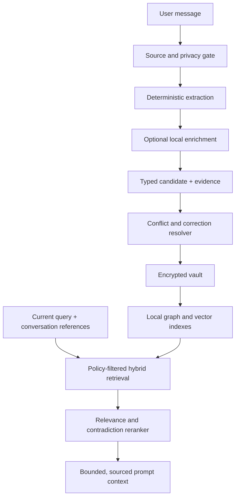

# Memory intelligence: repository audit and design

Audit date: 29 October 2026  
Repository: `tailscale-signin/GPT_Mobile_AI-improved`  
Audited base: `main` at `76ef0be9f09dd10cda8768db7d7d6b7a16c77d55`  
Status: source audit complete; this document proposes the next implementation sequence. No retrieval-accuracy result is claimed.

## Executive finding

The repository does not have a keyword-only memory system. It already has an encrypted fact vault, structured subject–relation–object facts, a local sentence-embedding model, hybrid lexical/semantic fact ranking, a Room knowledge graph, correction and deletion controls, and optional local-model enrichment.

The confirmed gap is that these pieces do not yet represent or retrieve conversational meaning consistently. Automatic learning mostly captures profile facts and source statements. It does not explicitly model a user's intent, a decision and its rationale, a product requirement, or the failure that motivated a correction. The active graph search uses FTS/LIKE text matching. Dense similarity is used in dispatched fact recall, but the read-only preview path is lexical. Thus the initial diagnosis is partly confirmed: semantic infrastructure exists, while meaning extraction, graph-aware recall, and path consistency remain incomplete.

## Source audit

| Area | Confirmed implementation | Design gap |
| --- | --- | --- |
| Write pipeline | `FactVaultRepository.prepareTurn` captures from the current user message. `MemoryLearning` excludes questions, quoted/code blocks, credentials, and opted-out text; deterministic patterns capture identity, preferences, constraints, goals, devices, and projects. Optional local enrichment accepts exact source statements rather than fabricated paraphrases. | No first-class record for intention, accepted decision, rationale, requirement, expected behaviour, failure, or correction relationship. Exact statement preservation protects provenance but does not itself derive these roles. |
| Storage | `FactVaultRepository` is the policy/source of truth; `MemoryRepository` persists versioned encrypted records; facts carry scope, evidence source, validity, confidence, review state, and supersession metadata. The graph is a derived Room index. | The principal fact model is still a fact/observation. It cannot cleanly bind one decision to its rationale and rejected alternatives, or track a requirement through later status changes. |
| Dense retrieval | `LocalSemanticMemory` runs the Universal Sentence Encoder on-device. The turn-dispatch path requests cosine similarity when semantic recall is enabled, then `MemoryRecallPolicy` combines semantic, lexical, intent, recency, and frequency signals. | Indexing uses a bounded in-memory fact-vector cache and can be incomplete while batches are processed. Retrieval accuracy and thresholds are not yet demonstrated on a representative paraphrase/correction benchmark. |
| Lexical / graph retrieval | `MemoryGraphRepository.searchNodes` uses FTS5 where available with LIKE fallback. Graph tools can expose entities, observations, relations, and bounded reads. | Automatic fact recall does not yet combine graph traversal with dense/lexical candidate retrieval. Graph search remains primarily surface-form dependent. |
| Preview vs dispatch | `recallReadOnly` ranks a snapshot without starting capture, indexing, or native work. `prepareTurn` can add semantic scores and performs capture/enrichment preparation. | The two paths do not share identical retrieval evidence: previews can omit a paraphrase match shown at dispatch. Any fix must preserve the preview path's nonblocking/read-only contract. |
| Corrections | Newer exclusive values can replace older ones; contradictory preference/avoidance records can be held for review; retries cannot override newer message IDs; edits and deletion tombstones are retained. | Conflict handling is relation-specific and does not yet connect “this is the correction to that earlier requirement/decision” as an explicit, queryable relation. |
| Prompt integration | Recall is bounded by configured count and token budget. Scope, review, retention, local-only, cloud-recall, and source-chat policies gate candidates before they reach the model. | Retrieved context is primarily a list of facts. The response model receives limited rationale, temporal evolution, or uncertainty structure to explain why a memory applies. |
| Connected memory | Optional connected providers are opt-in and return bounded untrusted reference data; the local vault is not automatically uploaded. | Treat this as a separate optional source; it must never become a prerequisite for local semantic recall or bypass local privacy/review rules. |

Relevant source files: `FactVaultRepository.kt`, `MemoryLearning.kt`, `MemoryRecallPolicy.kt`, `LocalSemanticMemory.kt`, `MemoryGraphRepository.kt`, `MemoryConsolidation.kt`, `MemoryRepository.kt`, and `MemoryImprovements` tests/docs.

## Recommended memory model

Keep the encrypted vault authoritative. Add a typed conversational-memory layer that points back to exact user-message evidence rather than replacing the original facts.

Each memory record should support:

- **Kind:** profile fact, preference, intent, decision, rationale, requirement, constraint, unresolved question, failure, correction, or project state.
- **Content:** a concise normalized statement, preserving negation, quantities, qualifiers, and modality.
- **Relations:** entity/project links and typed edges such as `motivated_by`, `constrains`, `supersedes`, `corrects`, `blocks`, and `resolved_by`.
- **Evidence:** source chat/message IDs, exact source span or quote, capture method, and any user-approved summary. Never treat assistant output or retrieved web/tool text as user intent.
- **Time and state:** observed time, valid interval, status, version, and explicit supersession/correction provenance.
- **Policy:** scope, sensitivity, local-only status, confidence, review status, retention, pinning, and tombstone linkage.

Do not infer rationale as fact. Save a rationale only when the user states it or approves a locally generated summary; otherwise store the decision and leave rationale absent. Keep uncertain interpretation as a reviewable candidate, not active memory.

## Meaning-aware pipeline

The graph and vector indexes remain rebuildable derived data. A missing model asset, native failure, or stale index falls back to lexical ranking without blocking the chat turn.

## Retrieval design

1. Apply privacy, scope, validity, review, retention, local-only, and cloud-recall filters before any fact is eligible for the prompt.
2. Build the retrieval query from the current request plus a small, same-chat reference window. Resolve “that issue,” “the earlier choice,” and similar references against recent entities/episodes; if several candidates remain close, ask for clarification or abstain.
3. Retrieve a bounded candidate union from exact/FTS search, local dense vectors, and graph-neighbour expansion. Include the read-only path without initializing native components; use cached scores when valid and lexical/graph fallback otherwise.
4. Rerank with separately observable signals: lexical match, dense similarity, entity/relation match, intent-kind match, temporal validity, confidence, recency, and contradiction/supersession penalties. Do not let repetition or recency rescue a candidate with no topical evidence.
5. Calibrate a minimum evidence threshold and return no memory when nothing clears it. Keep a hard token budget and include provenance IDs plus temporal/correction labels in the prompt representation.
6. Reuse one selection policy for preview and dispatch. The preview may use less evidence if it stays nonblocking, but it should label that result as provisional and must not imply it is identical to the final dispatched selection.

## Local-first and performance

- Keep extraction and the sentence encoder on-device by default; cloud assistance remains opt-in and is not part of the recall critical path.
- Batch new/changed embeddings, cache by stable record fingerprint plus model/version, and persist only rebuildable vectors. Do not embed every fact again on each launch.
- Make index generation/version explicit. A stale or unavailable semantic index must not hide lexical results or invalidate vault records.
- Respect the existing single-owner native-engine lifecycle, cancellation, memory admission, and thermal safeguards. Bound query length, candidate count, graph hops, work time, and token output.
- Log counts, stage timings, index generation, fallback reason, and score bands only. Never place message text, embeddings, or memory contents in diagnostics.
- Keep local-only facts out of cloud prompts and all connected-memory requests, including through graph expansion.

## Corrections and consolidation

Treat corrections as explicit events. A correction should point to the prior record, preserve the old version and evidence, set the new valid interval, and distinguish a change of preference from an additional compatible preference. Prefer deterministic conflict rules for exclusive values; require review where meaning or polarity is ambiguous. Duplicate consolidation must preserve qualifiers, relation type, scope, and source evidence. Similarity alone must never collapse “like” and “dislike,” intention and outcome, or a decision and its rationale.

## Evaluation and release gates

Build a fixed synthetic golden set, with a separate optional user-controlled local replay set. Include:

- Paraphrase retrieval with low or zero term overlap.
- “Why did I choose this?” with rationale explicitly present, absent, and only in assistant text.
- Newer preference/requirement correction, delayed retries, and compatible non-exclusive facts.
- Pronouns and demonstratives resolved within a chat and across project-scoped conversations.
- Entity/relationship joins across conversations with scope boundaries.
- Irrelevant questions and near-miss topics that should abstain.
- Review-pending, tombstoned, local-only, expired, and cloud-disabled cases.
- Preview/dispatch consistency and missing/stale/native-failure index fallback.

Retain the proposed 90% target as a minimum overall correct-retrieval rate on a versioned, representative set. Report precision@k, recall@k, abstention quality, correction freshness, privacy-policy violations, p50/p95 latency, index completeness, and prompt tokens separately. Require zero privacy/scope-policy violations in the golden set; do not trade those for recall. A raw synthetic-memory benchmark is not sufficient to claim production accuracy.

## Delivery sequence

1. **Baseline and contracts:** Add the golden evaluation corpus and instrumented selection traces using synthetic data; document current scores before changing ranking.
2. **Consistent retrieval:** Unify preview and dispatched selection policy, with read-only semantic cache access and a labelled provisional fallback.
3. **Typed conversational episodes:** Add schema/migration support for decision, intent, rationale, requirement, failure, and correction provenance; keep original fact records readable.
4. **Safe local extraction:** Add deterministic phrase/turn signals first. Allow optional on-device enrichment to classify only source-grounded candidates; require evidence span and user review for inferred relations/rationale.
5. **Hybrid retrieval and reranking:** Add candidate union and graph expansion behind a versioned feature flag, tune thresholds against the golden set, and preserve a lexical-only fallback.
6. **Prompt integration:** Serialize a compact evidence packet with source, time, status, and uncertainty; apply the same privacy and token-budget gates to every AI profile.
7. **Rollout:** Enable for synthetic and opt-in local replay first; inspect aggregate privacy-safe metrics, then gradually enable by profile/settings. Keep a one-tap disable/rebuild path.

The existing memory tests and quality suite are useful foundations, but they do not currently substantiate the 90% semantic-retrieval target. Add behavior tests for paraphrases, intent/rationale, contradictions, abstention, and the read-only preview contract before enabling the new path by default.

## Connected-memory boundary

Configured Mem0, Supermemory, or Graphiti connections remain optional. Remote retrieval receives only the bounded current query under the existing opt-in policy. Treat every response as untrusted quoted context, never as instructions or user-authored evidence. Do not synchronize the vault or write automatically to remote memory. Local deletion cannot imply deletion in a third-party account; the UI and audit trail must keep those lifecycles separate.

## Existing provider research

- [Mem0 MCP documentation](https://docs.mem0.ai/platform/mem0-mcp) describes its hosted endpoint and search tools.
- [Supermemory MCP tool reference](https://supermemory.ai/docs/supermemory-mcp/mcp) documents scoped semantic search.
- [Graphiti MCP server](https://github.com/getzep/graphiti/tree/6b4b56ff6f4b1e4e69c3c3c5487cf1b8762c483a/mcp_server) supports temporal facts and hybrid retrieval, but a configured server and generation/embedding endpoints are required.

Authenticated provider behavior, device latency, and semantic retrieval accuracy require runtime/device evaluation. This audit is source-level and makes no runtime accuracy claim.
