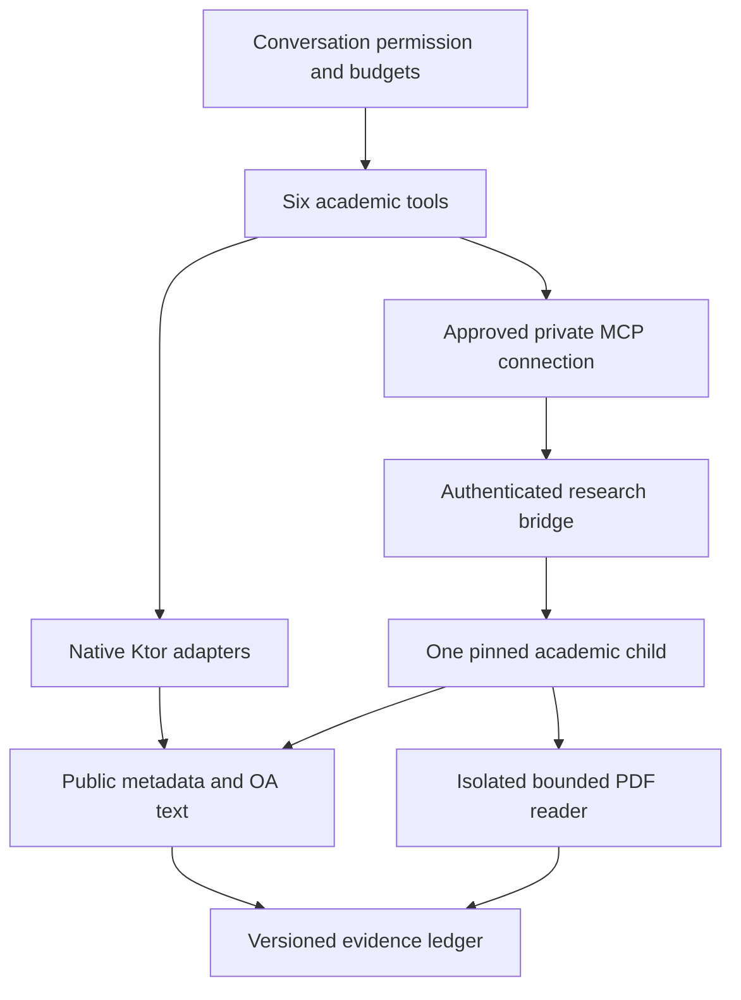

# Deep Research academic integration

For the subsequent shared reader contract, typed Examine recovery, turn manifests, funded delivery, heap-safe persistence and report correction implementation, see the [October 21 reliability repair record](repairs/2026-10-21-reliability-and-workspace.md). The sections below describe the original integration and its historical design baseline.

Branch: `feat/gpu-npu-execution-plans-2026-10-11`, based on `feat/qnn-full-reliability-v2-2026-10-11` (`5574590965a3a79571a16fa421979b4a3c2cc310`). Design input: *Deep Research Master Plugin Design Implementation Guide*, 11 October 2026. The user's requested base takes precedence over the guide's suggestion to start from main.

## User behavior and authorization

**Multi Search → Research** contains an explicit toggle, the existing 0–100 delegation strategy presented as Research Depth, and Web + Papers, Papers only and Web only scopes. Changing controls makes no academic request. Depth 0 or Research Off locks academic tools. Depth 1–34 uses Quick limits, 35–74 Research limits, and 75–100 Exhaustive limits. Existing custom page/round/link limits remain upper bounds. Quick permits metadata discovery, with zero full-text reads. Save profile default writes only the profile depth override; ordinary changes remain per conversation.

One `deep_research` service exposes six model-facing tools. Global enable, selected AI profile enable, explicit Papers and studies consent, network permission, the conversation selection, source mask and request budgets are checked independently. Old settings default dormant. Restoring preferences preserves depth/source choices but disables the academic toggle, gateway selection, automatic native fallback and plugin grant until the user enables them again. Tools-only restores do not replace unrelated UI or model preferences.

| Tool | Contract |
| --- | --- |
| `deep_research_search_papers` | Topic-routed discovery, at most three providers, 50 returned records, up to three bounded pages, year/review filters and per-provider receipts. |
| `deep_research_get_paper` | Cached identity or bounded DOI, arXiv, PMID/PMCID metadata resolution; unsupported identifiers fail explicitly. |
| `deep_research_read_paper` | Permitted OA HTML/XML on Android; bounded PDF extraction on a configured PC gateway. Metadata is never promoted to a successful read. |
| `deep_research_citations` | Up to 30 OpenCitations edges for a DOI, with direction and provenance. Edges do not mean agreement or claim support. |
| `deep_research_verify_evidence` | Exact quote occurrence in a captured version with an intact text hash, source URL and locator. This does not verify scientific truth. |
| `deep_research_status` | Execution owner, available/disabled sources and quota state; this call makes no provider query. |

The private MCP child exposes `academic__deep_research_*` to the Android connection. `AgentToolResolver` binds the original approved identity and presents the six stable names to the model. No provider-specific tool catalog is injected. The underlying MCP call keeps its existing client execution owner; gateway progress does not become a second client tool invocation. Name collisions are excluded.

## Native and gateway architecture

`AcademicNativeClient` uses Ktor/OkHttp, fixed public HTTPS origins, public-address DNS validation at connection time, redirect checks, a 2 MiB response cap, per-provider single-flight admission and a global three-request ceiling. Shared persistent quotas and Retry-After cooldowns survive app restart. Search results are cached for 30 minutes; paper metadata is reused instead of repeating a lookup before each read. Captured text snapshots are private, versioned and bounded to 128 files. Android adds no Python, Node, PDF parser or OCR dependency.

The optional PC facade is `mcp/research/academic/server.mjs` plus `gateway/v14/academic.py`. It uses the repository's existing authenticated research bridge and exactly one composite child. It does not create another public HTTP service. The Python router is SHA-256 pinned by `academic/manifest.json`; dependencies remain pinned by the existing npm lock. Source updates require review and a matching manifest update. This directly normalized HTTP implementation is the guide's allowed alternative to vendoring an unreviewed Paper Search MCP checkout.

One owner handles each operation. A completed gateway operation never triggers a native duplicate. Native fallback after a failed gateway operation requires the separate conversation checkbox, charges the budget again and marks coverage partial. Exact quote verification stays with the owner holding the captured snapshot. Connection/profile changes invalidate further access; cache possession cannot grant permission.

The facade reserves up to 30 physical-call units and 256 KiB of result bytes across its six tools, and caps reads by the effective depth policy. Search reserves its provider fan-out; a read conservatively reserves lookup plus acquisition. The research workflow also charges the existing shared discovery/verification budget, preserves a synthesis window, and checkpoints each completed read. Exhaustive mode can expand at most two citation edges from each of two seed records per wave, within the configured link depth and budget. Review requires a successful exact-version quote check before treating an academic passage as support.

## Provider registry and rollout

Five core anonymous endpoints returned one-record HTTP 200 responses during implementation. Bounded metadata fixtures and the smoke record are in `app/src/test/resources/academic/` and `docs/validation/academic-smoke-2026-10-11.json`. These are endpoint contract observations, not phone/VPN deployment tests or permanent service guarantees.

| Source from the design | Implementation / default state |
| --- | --- |
| OpenAlex | Core native and gateway metadata; conservative 50 anonymous calls/day shared across operations. |
| Crossref | Core DOI and bibliographic metadata; metadata is not publisher full text. |
| arXiv | Core topic-routed preprints; three-second pacing; exact version IDs; native HTML or gateway PDF. |
| PubMed | Covered through Europe PMC MED records; IDs from other collections are never mislabeled as PMID. |
| PubMed Central | PMCID/OA XML through Europe PMC; full text only when actually acquired. |
| Europe PMC | Core biomedical metadata/OA XML; documented cursorMark pagination. |
| DataCite | Core data/software/DOI metadata; resource type preserved; native pacing no faster than one call/5 seconds. |
| OpenCitations | Bounded DOI graph operation; separate source mask and quota. |
| dblp, DOAJ, HAL, Zenodo, INSPIRE-HEP | Gateway parser adapters present; disabled by the default operator registry pending their anonymous smoke/terms review. No claim of live qualification. |
| ROR | Enrichment-only registry entry; no paper search route, disabled by default. |
| Semantic Scholar, OpenAIRE, OpenReview, CORE, CiteSeerX, OSF | Disabled pending operation-specific anonymous contracts, rate/terms review and fixtures. They are not quietly substituted into the keyless default. |
| bioRxiv, medRxiv, IACR, ACL Anthology | Reserved specialized connectors, disabled pending verified contracts. Indexed records may appear through an already enabled index with that index's attribution. |
| SSRN via OpenAlex; ACM via Crossref | Metadata leads through those existing providers, not extra independent providers or full-text access. |
| Local Zotero | Optional separate user-owned collection connection; not enabled or read by this feature. |
| Unpaywall, IEEE, Google Scholar scraping, BASE, ORCID search, commercial indexes, Sci-Hub | Excluded from the strict zero-credential default; no email guessing, access-control bypass or mirror fallback. |

Optional source enablement needs an explicit reviewed operator registry change and corresponding fixtures. Selecting a source in Android cannot bypass the gateway's disabled registry. The UI exposes the validated native core plus OpenCitations; disabled specialist implementations are not advertised as working sources.

## Evidence and security contracts

DOI duplicates merge provenance and receipts only for matching version keys. arXiv versions, deposited/published versions and text hashes remain distinct. Title similarity never merges text evidence. Unknown peer review, retraction, year or license remains unknown. No citation-count quality score is inferred.

Academic records survive the existing research checkpoint/Combined evidence path with paper ID, version ID, receipts, read status and exact excerpts. Answer source cards show academic identity, provider provenance, review state and version. The gap reviewer explicitly seeks conflicting evidence; agreement among models is not independent evidence. Provider partial/empty/rate-limited responses remain partial/empty rather than fabricated papers.

The gateway resolves and pins public IPs while retaining TLS certificate/SNI validation. Every redirect must match the fixed host registry, source filters and public-address requirement. Responses are bounded; hostile XML declarations are rejected. PDF input is capped at 12 MiB with a `%PDF-` signature, first 40 pages, 20-second parent deadline, 15-second parser CPU limit and 512 MiB process memory. POSIX limits are applied in a separate helper before exec; Windows uses a kill-on-close Job Object. If resource limits cannot be installed, extraction fails closed. Windows Job Object behavior still needs a Windows host test. The optional `pdftotext` binary is installed by the operator, never downloaded/executed from paper content. Text is bounded to 24,000 characters and labeled partially read; page excerpts retain page numbers. No scripts, URL subresources or OCR are executed.

Gateway arguments are validated with strict schemas; unknown fields and unbounded fan-out are rejected before dispatch. Only six read operations are allowlisted. Bridge Bearer credentials are not forwarded to providers. No credentials occur in config examples, URLs, fixtures or source locks. Native and gateway outputs are untrusted evidence, not tool instructions. Existing authorization remains the authority for ordinary Web Search and delegation.

## Validation and acceptance map

See [the validation record](validation/implementation-2026-10-11.md) for executed commands and results. A test mapping is not a claim that the physical-device release gate has run.

| Guide cases | Automated coverage / remaining gate |
| --- | --- |
| DR-001–004, 028 | Dormant/zero-depth/scope/plugin contracts and per-chat policy tests; source resolution checks; UI interaction with traffic capture still needs device instrumentation. |
| DR-005, 019 | Five live anonymous endpoint fixtures, native parser tests, explicit native PDF-unavailable contract; phone-only network test pending. |
| DR-006–007, 014 | Real stdio and authenticated HTTP composite tests, wrong/missing Bearer and foreign Origin denial, fixed child and schema tests; Android binding/collision code retains existing checks. |
| DR-008–009 | DOI receipt merge, distinct preprint versions, hashed snapshot tests. Automatic cross-provider version linking is only supported when explicit metadata is available, not inferred by title. |
| DR-010–011 | Shared cooldown, quota restart and concurrent reservation tests on enabled providers; Semantic Scholar/OpenAIRE themselves remain disabled, so their live gates remain pending. |
| DR-012–013, 023, 025 | Cancellation checks, deadlines, live permission rechecks and explicit fallback code; Android lifecycle, gateway disconnect and in-flight revocation require device tests. |
| DR-015–017 | Metadata not-read, altered hash/version/quote rejection, false PDF rejection, actual bounded synthetic PDF extraction with page locator and exact quote. |
| DR-018 | Fixed HTTPS/DNS, redirect and domain policy; excluded-domain cached quote test. |
| DR-020 | Legacy defaults and restore sanitization tests; unrelated settings retained. |
| DR-021–022 | Atomic physical fan-out/read/byte budget tests, canonical provenance, cache and existing Combined checkpoint path; multi-device recall/performance study pending. |
| DR-024, 026 | Untrusted-data prompt boundary, fixed read-only tools, OA/metadata distinctions; publication validity and licenses are not inferred. |
| DR-027 | Partial sibling and unavailable-provider fixtures, no invented fallback rows. |

Release still requires Android instrumented tests, signed APK qualification, real phone-only and PC-assisted runs, Windows parser-limit verification, and the guide's labeled 40-query recall/relevance/evidence evaluation. No API availability, phone performance, paper recall or battery gain is asserted from unit tests.
