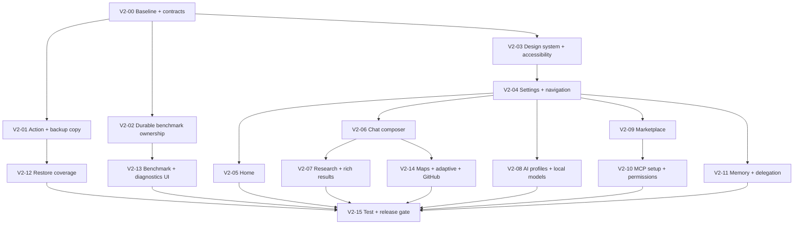

# GPT Mobile AI Improved — Full UI/UX Design & Implementation Specification V2

> **Design document, not an implementation claim.** All original 105 recommendations and 10 V2 additions are mapped to implementation work, verification criteria, and affected repository modules. No source modifications, builds, pull requests, or device tests are claimed by this document.

| Field | Value |
|---|---|
| Document ID | `DESIGN-UI-OVERHAUL-V2-2026-10-10` |
| Document status | **V2 validated against repository source** — implementation, build and device verification pending |
| Date | October 10, 2026 |
| Repository | [`tailscale-signin/GPT_Mobile_AI-improved`](https://github.com/tailscale-signin/GPT_Mobile_AI-improved) |
| Source baseline | `main` @ [`4b8e5444f8d94e5769889c9b9fe5a9f77df15080`](https://github.com/tailscale-signin/GPT_Mobile_AI-improved/commit/4b8e5444f8d94e5769889c9b9fe5a9f77df15080) |
| Baseline app version | `0.9.41.0` in `app/build.gradle.kts` (versioning can advance separately) |
| Android namespace | `dev.chungjungsoo.gptmobile`; release application ID `dev.melo.gptmobile.improved` |
| Delivery target | Android / Jetpack Compose Material 3; compact, medium, expanded, foldable |
| Scope | UI audit changes **#001–#105** plus V2 additions **#106–#115**; confirmed implementation discrepancies differentiated from proposals |
| Intended repo destination | `docs/design/GPT_Mobile_AI_Full_UI_UX_Design_Implementation_V2_2026-10-10.md` |
| Related document | Legacy [`UI_IMPROVEMENTS.md`](../../UI_IMPROVEMENTS.md) — retain as historical documentation, do not treat historical claims as current behavior |

---

## 0. V2 source audit and decisions (reviewed 2026-10-10)

**What was checked:** the V1 artifact, the live repository tree/default branch and selected current-source implementations, the app's Gradle/catalog versions, active chat/home/profile/marketplace/backup/benchmark/map paths, the existing macrobenchmark/CI structure, and official Android design/lifecycle guidance. Repo code was read through the GitHub connector. **No Android build, live UI screenshot capture, battery profiler, CI run, fresh-device restore, or physical-device inspection was performed.** Claims about rendering, jank, Android runtime success, and pixel-perfect logo match therefore remain test hypotheses.

**Baseline:** `main` SHA `4b8e5444f8d94e5769889c9b9fe5a9f77df15080`; `app/build.gradle.kts` version `0.9.41.0`, namespace `dev.chungjungsoo.gptmobile`, release ID `dev.melo.gptmobile.improved`, compile/target SDK 37. Snapshot is pinned for the design; revalidate against then-current `main` at implementation time.

### 0.1 Corrections to V1 (highest-value changes)

| V1 assumption / item | Verified current behavior | V2 decision |
|---|---|---|
| #001: Disable Platform doesn't work | Chat menu calls a toast; **`ChatViewModel.togglePlatformDisabled(uid)` and `setPlatformMembership(uid,active)` already exist**. | Connect menu to existing conversation-scoped API; let user select profile. Do not invent backend action or globally disable a provider. |
| #003: 1-second marketplace refresh is a critical bug | `McpMarketplaceScreen` increments a clock every second for availability state. An actual performance regression is **not measured**. | P1 performance investigation: make clock visible-item scoped/event-driven; benchmark before claiming optimization. |
| #005: blank top bar requires a new heading | Normal `HomeTopBar` has a blank `title`, but the home also has `ChatsTitle`/tab headings. | Review entire header hierarchy so adding a title does not duplicate the heading. P2, visual verification first. |
| #020: delete lacks safety | `HomeScreen` already has a delete-confirmation dialog; swipe archive already has **Undo**. | Preserve existing protections, extend to every destructive path, test archived/bulk behavior. No wholesale rewrite. |
| #026: composer Send/Stop issue | `showStop` is true only while running with an empty draft and no attachments; typing changes the button back to Send. | Confirmed functional UI issue: allow independent Stop and Send during generation. |
| #041: scroll handling needs replacing | Existing code contains a response-boundary controller, auto-follow and entry positioning. | Reproduce failures, preserve current algorithms, add targeted instrumentation, avoid a new scrolling framework. |
| #053: local compatibility absent | `LocalModelsScreen` already shows chipset, RAM, LiteRT/QNN filters and model variants. | Extend with verified actual runtime status, download preflight and ambiguity labels, not another marketplace. |
| #061: all tools need lengthy setup | Current MCP setup is a long dialog, but many preinstalled/local tools require no endpoint or OAuth. | Wizard only for complicated connections; lightweight setup for simple options. |
| #065: eager list is critical performance bug | `ToolConnectionsScreen` uses `Column.verticalScroll` with `forEach`; actual service count/jank not benchmarked. | Prefer eager for small bounded lists, lazy for large/unbounded collections; evaluate before changing. P2. |
| #071: missing neutral dark palette | `ThemePresets` already contains **Graphite** and **Midnight**. | Reuse existing presets, don't add a duplicate Graphite-like theme or silently alter defaults. |
| #080: backup support is missing | `CompleteBackupSelection` has SETTINGS/TOOLS/STATISTICS; native plugin ZIPs and registry are collected for TOOLS. Benchmark history uses separate `benchmark_v2.db` plus `profile_benchmarks_v1` preference mirror. | Verify exact selection/restore guarantees, especially STATISTICS-only vs SETTINGS and separate database; add missing serialization only if tests fail. |
| #084: local vs remote scoring not implemented | `DynamicScoreEngine.cohort()` already separates device, self-hosted, remote, power/network policy and scoring weights; dynamic speed anchors also exist. | P1 correctness/UI proof: test and explain the existing cohorts; do not replace the score engine. |
| #085: benchmarks already keep running across screens | **False currently:** benchmark `job` is in `ProfileBenchmarkViewModel`, with explicit cancel on `onActivityStopped`. | New P0 #107: app-scoped durable job ownership; background execution subject to Android restrictions; UI observes, never owns the work. |
| #095: need a macrobenchmark framework | `macrobenchmark/AppPerformanceBenchmark.kt` and `device-validation.yml` already exist. | Extend existing performance journeys, don't add duplicate harness. |
| #100: map needs dark style / basic lifecycle | MapLibre view uses dark OpenFreeMap style, disallows parent touch interception on touch down, and calls `onPause`, `onStop`, `onDestroy`. | Target remaining reported panning conflicts with device tests; add fallback/fullscreen, not second MapView or duplicate dark map. |
| #104: exact icon can be guaranteed by reading code | A themed icon component exists, but source presence alone cannot establish fidelity to an external reference image. | Require approved reference asset + screenshot/golden comparison before signing off exactness. |
| #106: backup explains password correctly | `CompleteBackupDialog` says password is included inside the archive. `CompleteBackupManager` writes `.copy(password="")` and excludes password references. | New confirmed P0: repair misleading recovery/portability copy; test actual password/recovery-key flows. |

**V2 priority totals:** 15 P0 (critical), 88 P1 (core), 12 P2 (optional), **115 total tracked requirements**. These are *implementation priorities*, not assertions that an untested device bug exists.

### 0.2 Prioritization standard

**P0 (must-fix correctness/security/accessibility):** confirmed broken action, user-data or recovery trust risk, critical control hidden/unusable, permissions misrepresented, durable long-run work losing execution, or indispensable accessibility blockers. **P1 (core product improvements):** high-frequency usability, navigation, screen organization, rich evidence UI, performance improvements backed by profiling, robust recovery and validation. **P2 (optional/refinement):** cosmetic polish, evidence-limited enhancements, density preference, task recommendations, or features with additional complexity and uncertain payoff.

Do not assign P0 just because a code smell exists. Measure impact, user frequency and regression risk first. Gate every feature to preserve existing functions already shipped.

### 0.3 Inspiration grounded in current source and official guidance

- ChatGPT mobile release notes emphasize simplified model picking, a concise sidebar, composer improvements, image previews, and optional one-message model selection on mobile. **Adopt clarity, not a cloned interface**: [ChatGPT release notes](https://help.openai.com/en/articles/6825453-chatgpt-release-notes).
- Linear's redesign favors calmer hierarchy, contrast and reduced chrome, and its January 2026 mobile update supports user-customizable navigation; consider pinning favorites without turning the chat into a permanent tab-bar app: [Linear redesign](https://linear.app/now/how-we-redesigned-the-linear-ui), [Linear mobile navigation](https://linear.app/changelog/2026-01-22-customize-your-navigation-in-linear-mobile).
- Android's current Material 3 supports Expressive motion and adaptive layouts without requiring a custom controls rewrite: [Material 3](https://developer.android.com/develop/ui/compose/designsystems/material3), [adaptive navigation](https://developer.android.com/develop/adaptive-apps/guides/build-adaptive-navigation).
- Compose guidance explicitly favors *small eager collections* and large keyed lazy lists, deferring reads and measuring release-mode metrics: [lazy lists](https://developer.android.com/develop/ui/compose/lists), [best practices](https://developer.android.com/develop/ui/compose/performance/bestpractices).
- For accessibility, use Material defaults and supplement custom gesture controls with semantic actions, 48dp targets and verified font/contrast handling: [Compose API defaults](https://developer.android.com/develop/ui/compose/accessibility/api-defaults), [custom actions](https://developer.android.com/develop/ui/compose/accessibility/semantics).

### 0.4 Explicitly rejected or deferred changes

1. **Do not force permanent four-tab bottom navigation on compact chat**. Evaluate a contextual drawer or screen-specific header and adapt to rail only where width permits.
2. **Do not create a second state repository for cards, sources, benchmarks, plugins or memory**. Observe authoritative existing flows; extract shared components only.
3. **Do not replace Cyan or other selected custom themes**. Graphite already exists; show a voluntary alternative instead.
4. **Do not add offline/connected/supported badges from weak catalog guesses**. Unknown and test-required states remain explicit.
5. **Do not insist on a multi-step setup wizard for a no-auth built-in plugin**. Match friction to real setup requirements.
6. **Do not optimize eager lists or ticker recomposition without profiling the user journey**. Build tests before performance claims.
7. **Do not promise exact icon fidelity without the approved reference image or dedicated screenshot tests**.
8. **Do not imply Android background work is unconditional**. Respect WorkManager/foreground-service restrictions, thermal conditions and user notifications.
9. **Do not overwrite backup/restore formats or security settings to support cosmetic layout**. New data support must be versioned and tested.
10. **Do not add always-on cloud telemetry, hidden internet probes, or unnecessary permission checks** solely to animate statuses.

---

## 1. Executive decision

The product needs **one coherent visual and interaction system**, not additional independent cosmetic redesigns. Keep the app's distinctive advanced features—multi-profile/Combined chat, local LiteRT/QNN runtimes, tools and MCP, research, memory, diagnostics, benchmark suites, GitHub workspace—and put them behind **predictable, progressively disclosed navigation**. Fix broken or misleading actions before introducing new chrome. Avoid rebuilding already-functional capabilities just to match another app's appearance.

**Primary user outcome:** A new user can start a conversation and choose a model without learning the app's technical hierarchy; an experienced user can reach every deep setting, tool, and performance diagnostic without losing context. The resulting UI remains fast on a phone performing on-device inference.

### 1.1 What is established, proposed, and unverified

- **Confirmed from baseline source:** (C1) Chat *Disable Platform* menu is toast-only even though `ChatViewModel` already exposes membership/pause operations; (C2) Settings Search only indexes a partial set of controls; (C3) Composer Stop disappears while typing during an active generation; (C4) benchmark execution is screen-owned and explicitly canceled on Activity stop; (C5) backup recovery wording incorrectly claims the password travels in the archive. The marketplace has a one-second clock, but its battery/performance impact is **unmeasured**, not a confirmed crash.
- **Present already; improve rather than duplicate:** Compose navigation graph and multiple routes, theme and custom palette providers, responsive two-pane `AdaptiveConversationLayout`, folder/pin/archive gestures, combined-profile bubbles, source presentation, plugin installation state, local catalog tabs, debugger/statistics/benchmark tabs, backup selection, macrobenchmark module, accessibility semantics on some components.
- **Design recommendations:** Remaining audit items represent design/engineering opportunities. Source presence **does not prove** an end-user bug or device-level performance problem. Verify each hypothesis with instrumentation or usability checks before marking it fixed.
- **Device and screenshot validation pending:** No claim of full visual inspection across runtime screens, translations, font scaling, 60/90/120 Hz animation, foldable posture, or TalkBack.

### 1.2 Hard constraints / non-goals

1. Preserve user data, conversations, profile IDs, permission grants, plugin package state, backup compatibility, run history, and saved view preferences.
2. Do not alter model inference, delegation ownership, MCP security, or gateway behavior unless required to fix a documented UI-state inconsistency; isolate cross-layer changes behind explicit contracts.
3. No large framework rewrite, Compose-to-Views migration, Navigation 3 conversion, or replacement of existing state repositories for cosmetic reasons. Consider upgrading navigation libraries separately after an API/version compatibility review.
4. Treat QNN/LiteRT model compatibility as **measured backend facts**, not aesthetic badges. Never claim device compatibility from catalog labels alone.
5. Preserve the approved icon's exact vector proportions and path geometry; theme only intended foreground/background tokens. Never distort it to fill a square.
6. New UI cannot silently enable remote tools, grant permissions, change privacy policy, download models on metered connections, or destroy saved data.
7. Do not deploy all 115 changes in one giant PR: use feature-gated, independently validated increments.

## 2. Product experience goals and acceptance gates

| Goal | Product-level acceptance evidence |
|---|---|
| Discoverability | All common chat operations accessible from chat/home without a settings detour; technical controls remain searchable |
| Clarity | Each card or dialog has at most one visually dominant primary CTA; statuses name actual states; provider, profile, plugin, and MCP server are not conflated |
| Consistency | Shared spacing, color roles, typography, components, dialogs, icons, and animation tokens used across all touched screens |
| Accessibility | 48 dp interactive targets, clear semantic labels/states/actions, TalkBack traversal, no critical color-only information, font scaling/RTL tested |
| Responsiveness | Small portrait devices have no clipped or hidden primary actions; large screens use available width responsibly and restore pane state |
| Reliability | Cancelling, resuming, deleting, saving, and enabling actually perform their intended operations; UI state survives rotation/process recreation where appropriate |
| Performance | Measured release-like scroll, startup, keyboard, marketplace, long-chat, and map workloads show no material regression against captured baseline |
| Trust | Source/evidence and data access are visible; diagnostics/export redact secrets; connections/installations have truthful online/installed/enabled states |

**Definitions of Done for every ID:** production code + associated state/restore behavior + loading/empty/success/failure appearance + Compose semantics/test tags + relevant tests + screenshots on standard theme variants + no new warning-level lint/accessibility regressions. Feature-specific gates are recorded in §12.

## 3. Information architecture and navigation

### 3.1 Proposed information hierarchy

```text
App shell
├── Conversations  [default]
│   ├── All, Favorites, Folders, Archive, Search
│   └── Chat detail
│       ├── active profile / mode selection
│       ├── composer, queued prompts, attachments
│       ├── combined profiles, research progress, sources
│       └── response details / export / history
├── AI
│   ├── Profiles [Remote / Local / Free filter]
│   ├── Providers & connections
│   ├── Local models [Library / Discover / Browse / Downloads / Runtime]
│   └── Benchmark shortcut
├── Plugins & Tools
│   ├── Installed & enabled services
│   ├── Marketplace [Plugins / Remote MCP]
│   ├── Connections, permissions & health
│   └── Delegation quick settings
└── Settings
    ├── Search all settings (real index)
    ├── Appearance
    ├── Memory (facts / documents / review / controls)
    ├── Delegation & research
    ├── Privacy / background / advanced
    ├── Backup & restore
    ├── Debug / Statistics / Benchmarks
    └── About
```

**Compact phones:** Use a lightweight drawer or contextual navigation for infrequent destinations. Favor a conversation-first home; do **not** force a persistent four-item bottom navigation on small chat viewports if it compromises the composer. **Medium/expanded:** Prefer NavigationSuiteScaffold-style adaptive rail/drawer after dependency review, reusing the existing two-pane chat behavior. Do not introduce a second back stack by accident. Preserve proper deep links and `popUpTo` behavior.

### 3.2 Navigation implementation rules

- Continue using `presentation/common/NavigationGraph.kt` and `Route.kt` as authoritative routing until a separate migration is approved.
- Introduce typed/centralized **destination descriptors** (stable ID, title resource, route, group, analytics ID, search keywords, prerequisites), without changing existing serialized conversation identifiers.
- Maintain the current `chat_room/{chatRoomId}` route's behavior for enabled profiles, conversation mode, target message, regenerate, incoming shares. Add deep link regression tests, especially for searches and favorites.
- Wrap route transitions in shared settings and conversation navigation behavior: consistent 200–300 ms defaults, predictive-back compatibility if applicable, no animations that delay returning to active chat.
- Adaptive layout: compact = single detail pane; wide = list/detail with existing `AdaptiveConversationLayout`. Do not run two ChatViewModels for one conversation as the hinge/width changes.
- Keep **one source of truth for route selection**, including settings search. Navigating to a hidden tab must choose that tab and focus or highlight the requested control.

### 3.3 Suggested wireframes (structure, not final visual design)

**Home:**

```text
┌─────────────────────────────────────────────┐
│ ☰  Conversations                  ⌕      ⚙  │
│ All Chats  ·  Favorites  ·  Folders          │
│─────────────────────────────────────────────│
│ ⎘  UI architecture review            7:35  │
│     Combined • 3 models • Completed          │
│ ⎘  Local QNN benchmark               6:50  │
│     Gemma 4 • Saved • New result             │
│ ⎘  Marketplace connection audit      Friday│
│     Deep Research • 12 sources               │
│─────────────────────────────────────────────│
│                    [+ New Chat ▾]           │
└─────────────────────────────────────────────┘
```

**Chat:**

```text
┌─────────────────────────────────────────────┐
│ ←  Conversation title       [Model ▾] [⋮]  │
│─────────────────────────────────────────────│
│ User / Assistant content                    │
│ [Research · Reading sources  3 / 6]        │
│ [3 profile contributions ▾]                │
│ Final response                              │
│ Sources: [1] [2] [3] [All sources]           │
│ Actions:  Copy | Select | More             │
│                                            ↓│
│ [+]  Message…                    [Send/Stop]│
└─────────────────────────────────────────────┘
```

**Marketplace:**

```text
┌─────────────────────────────────────────────┐
│ ←  Marketplace                    ⌕   ⋯     │
│ Plugins | Remote MCP                        │
│ Search integrations…                       │
│ Filters (2)  •  Recommended ▾              │
│─────────────────────────────────────────────│
│ [Icon] Web Search              [Installed] │
│        Search multiple sources             │
│        In-app • Internet required          │
│                         [Manage] [⋯]        │
│ [Icon] Calendar MCP            [Setup]      │
│        Connect an external service         │
│        Hosted • Sign-in                    │
│                        [Connect] [⋯]        │
└─────────────────────────────────────────────┘
```

## 4. Shared design system and Compose architecture

### 4.1 Tokens

Build on existing `presentation/theme/{Theme,Color,Type,Motion,ChatAlphaTokens}.kt` and `presentation/ui/setting/SettingsDesign.kt`. Do **not** build a second parallel MaterialTheme. Define semantic, device-independent token objects using `CompositionLocal`s only when MaterialTheme cannot express a role.

| Token group | Initial design proposal | Implementation rule |
|---|---|---|
| Spacing | 4, 8, 12, 16, 24, 32 dp | Semantic aliases: `spaceXs`, `spaceSm`, `spaceMd`, `spaceLg`, `spaceXl`, `space2Xl` |
| Screen margins | Compact 16 dp; medium 20–24; expanded responsive pane padding | Keep all essential controls inside system insets |
| Radius | Input 16 dp; card 16–20; sheet 24–28; pill full | Exceptions for product cards and brand geometry documented |
| Touch | ≥48 × 48 dp touch bounds; visual icons commonly 20–24 dp | `minimumInteractiveComponentSize` / `sizeIn` where appropriate |
| Typography | Material type scale + existing Proxima Nova; scalable `sp` | Code and metrics use monospace; do not hard-code fixed row heights |
| Surfaces | `surface`, `surfaceContainerLow`, `surfaceContainer`, `surfaceContainerHigh` | Use tonal layering, not unbounded custom alpha overlays |
| Emphasis | Primary for primary action/selected state; secondary for nonessential decoration | Errors, warnings, success have unique semantic roles, with icon + text |
| Motion | fast ~120–180 ms; normal ~200–300 ms; deliberate expansions ~300 ms | Avoid continuous animation unless conveying actual live status |
| Reduced motion | React to platform animation scaling/reduced-motion policy | No animation may be required to understand a state |
| Contrast | WCAG AA reference: normal text ≥4.5:1, large text and nontext UI ≥3:1 | Runtime contrast validation for user-created palettes; exceptions explicitly tested |

The current default dark theme deliberately uses cyan and magenta. **Keep it as a named preset**. Offer a calmer neutral-dark preset; do not alter existing user themes in place. Preserve dynamic wallpaper color when explicitly enabled.

### 4.2 Shared components to create or consolidate

Suggested Kotlin package: `presentation/designsystem/{tokens,components,semantics,layout}` and `presentation/navigation/`. Names are proposals; prefer moving/reusing existing components over duplication.

- `AppScreenScaffold`: consistent app bar, back action, edge-to-edge/safe insets, screen title, error banners, snackbar host, layout max-width policy.
- `AppSectionHeader`, `AppSettingsRow`, `AppInformationRow`, `AppStatusChip`, `AppActionMenu`, `AppEmptyState`, `AppErrorState`, `AppLoadingState`, `AppSearchField`, `AppFilterSheet`, `AppHelpButton`.
- `AppResourceCard` with compact/comfortable variants; `ModelProfileCard`, `MarketplaceServiceCard`, `ChatListRow`, `SourceChip`, `RunStatusRow` composed from it, not tied to one static height.
- `AppSheetScaffold` for model/tool selection, filter groups, and quick actions; `AppFormScreen` for multi-step MCP setup and other lengthy flows.
- `AppFeedback`: snackbar/undo/inline field error/progress banner; eliminate arbitrary toast messages for durable failures.
- `AppIcon` and `ThemedAppIcon` wrapper providing stable vector aspect ratio, circular clips only where desired, accessible description, and color-role propagation.

Use Material 3 component semantics and interaction APIs whenever possible; layer branded visuals rather than rebuilding controls from raw `Box` and `pointerInput`. For screen-specific exceptions, record rationale.

### 4.3 UI state and lifecycle

Adopt `UiState` sealed types for new flows:

```kotlin
sealed interface UiLoadState<out T> {
    data object Loading : UiLoadState<Nothing>
    data class Ready<T>(val value: T) : UiLoadState<T>
    data class Empty(val explanation: UiText, val nextAction: UiAction?) : UiLoadState<Nothing>
    data class Failed(val message: UiText, val canRetry: Boolean) : UiLoadState<Nothing>
}
```

- Keep server/network/domain decisions in existing repositories and ViewModels; Compose observes stable, immutable *render state* using `collectAsStateWithLifecycle()`.
- Keep transient visible UI selection using `rememberSaveable` where safe, with stable keys. Never save credentials/API keys or secret endpoint values via `rememberSaveable`.
- Long-lived downloads, agent runs, backups, benchmarks, and interruptions must be sourced from a durable coordinator/repository, **not** tied to a composable's `remember` lifetime.
- Prefer `LazyColumn`/`LazyVerticalGrid` with stable keys and content types for potentially large collections; keep filtering/sorting out of hot item composition.
- Use event-driven Flow/StateFlow updates and `Lifecycle`-aware collectors; any ticker must operate only while its consumer is visible and must avoid invalidating the entire parent screen.
- `@Stable`/`@Immutable` only where correct; verify actual recomposition/skipping with Layout Inspector and macrobenchmark.
- Prefix stable UI automation tags by domain: `home_`, `chat_`, `profile_`, `marketplace_`, `settings_`, `benchmark_`, `memory_`, `backup_`.

## 5. Feature architecture and integration contracts

### 5.1 Settings discovery (audit #002, #067–069)

The current search only knows `AppFeature.entries` and a textual map of high-level destinations. Replace with **declarative settings registry** that covers settings at the screen, tab, subsection, and individual-control level. Proposed model:

```kotlin
data class SettingDestination(
    val key: String,                 // stable, unique; not visible title
    @StringRes val title: Int,
    val keywords: List<String>,
    val route: String,
    val tabKey: String? = null,
    val sectionKey: String? = null,
    val availability: SettingAvailability,
    val ranking: Int = 0
)
```

- Build entries from shared descriptors close to the owning screen, aggregate in `SettingsRegistry` and index text plus synonyms in memory. Local-only, no network indexing.
- Only expose toggles inline when the setting's owner permits safe direct updates and a complete state is available; otherwise navigate to the control.
- Implement exact/starts-with/keyword matching before fuzzy ranking. Debounce if measured necessary; do not add embedding/vector search for a few hundred settings.
- Results show title, breadcrumb (e.g., `AI → Profile → Tools`), matching subtitle, state when safe, and action. Invalid/deleted provider/profile destinations show a helpful fallback.
- On result click, navigate to the owning route and tab, preserve current navigation/back behavior, and focus/scroll to the control after layout.
- Search must cover gated and hidden features without implying they are enabled. Display `Requires debug mode` / `Connect a provider first` rather than silently omitting or activating them.
- Test all registry entries for duplicate keys, unreachable routes, orphaned search terms, and localization-safe labels.

### 5.2 Chat action contracts (audit #001, #026–042)

- **Disable Platform fix:** Bind the visible action to the current conversation's *actual active profile set*. Confirm applicable permissions and whether one profile remains; update the chat state via `ChatViewModel` domain operation; show the resulting state; don't silently disable a global provider. If operation is not allowed, disable/hide the action instead of a toast-only stub.
- Make the composer state explicit: `Idle`, `Generating`, `AwaitingToolApproval`, `QueuedFollowup`, `Stopping`, `Disabled`, `Error`. `Send` and `Stop` must have clear roles and remain reachable when text is present during generation.
- Separate presentation from existing queue persistence: render ordered queued prompts, editing and cancellation, and recovery without changing queue semantics.
- Distinguish source references, cited lines/snippets, research-stage state, and per-profile contributions. **Never fabricate** evidence coverage: only present metadata recorded by the run/evidence model.
- Preserve `LatestResponseBoundary`, `ConversationEntryPosition`, `ChatBottomAutoScroller`, and the lazy message list; modify only after a regression scenario demonstrates a scrolling fault.
- `CombinedProfileBubbles` remains a presentation of already persisted response state. Do not change synthesis algorithms solely for UI. Provide `contribution = included / partially included / not included / unknown` **only when traceable evidence exists**.
- Source preview/card controls must respect the origin and safety constraints of data from MCP and web results; sanitize Markdown/URLs and avoid loading remote assets into privileged WebViews.

### 5.3 Plugins and Marketplace (audit #003, #054–065)

Define **distinct states**: available catalog entry, downloaded package, installed integration, authenticated connection, enabled service, granted profile permission, and healthy tool endpoint. Avoid collapsing them into one `isInstalled` flag.

```text
Catalog item → Downloading → Integrity checked → Installed
                                   ↓
                              Setup required → Connected → Health checked
                                                       ↓
                                        Profile permissions → Ready for use
```

- Installation must remain separate from enabling and authorization. Native plugins run on Android; a plugin that invokes public internet endpoints is not an offline plugin. Remotely hosted MCP tools are not automatically installed binaries.
- Header filter region becomes collapsible/scroll-away; search stays available. Filters: status, category, runtime, pricing, sort. A filter button opens a sheet with selected-count and Reset.
- `MarketplaceServiceCard` summary: icon/name; max-two-line description; quiet runtime line; one truthful state label; one primary action; overflow. Expanded detail handles capabilities, source, data handling, prerequisites, and secondary actions.
- MCP connection wizard screens: Choose service → endpoint/local-network check → authentication (secret entry, never persisted in UI saved state) → connectivity/tool discovery → permissions/profile assignment → outcome.
- Reuse existing `ToolConnectionsViewModel`, `MarketplaceViewModel`, `ToolPolicyDialog`, and `NativePluginSettings`. Avoid new parallel preference stores or registry duplication.
- Replace unconditional one-second marketplace clock with a lifecycle-aware, visible-item-scoped update where expiry UI actually requires a countdown. Else update on installation/health/workflow events.
- Preserve cancel/retry, stalled-download handling, and existing package integrity checks. Warnings should distinguish verified failure from offline, auth failure, permission denial, timeout, or setup issue.
- Refactor large scrollable `Column` service lists into keyed lazy items, but keep nested action state stable across scrolling and rotation.

### 5.4 AI profiles and local model catalog (audit #043–053)

- The user-facing object is **AI Profile**; its model/provider/runtime are properties. A connection is shared infrastructure; do not display a shared API token as an editable field in every profile.
- Profile picker supports filters Remote, Local, Free; favorites, labels, capability badges, and measured performance. Single-selection and multi-profile Combined flows reuse common search/filter/list elements.
- Runtime eligibility decision is grounded in actual device chipset, installed engine binaries, model asset metadata, QNN packaging/runtime status, LiteRT fallback, and minimum RAM/disk. Catalog `supportedAccelerators` alone cannot guarantee successful execution.
- Treat locally measured throughput/thermal/latency separately from cloud benchmark metrics. Display evidence freshness and sample count when rankings are used in recommendations.
- Do not add continuous model probes during scrolling. Async diagnostics run from explicit checks or safe lifecycle refresh.
- Replace fixed-height settings rows with min-height and wrap; preserve the existing behavior of advanced sliders and backend-specific disabled states.

### 5.5 Memory, delegation, backup, and diagnostics (audit #075–087)

- Memory tabs: Overview, Saved Facts, Documents, Review, Controls. Use existing FactVaultViewModel and policy source; don't introduce a second memory store. The UI never implies low-confidence extracted facts are confirmed facts.
- Per-memory details show source, extraction confidence where recorded, scope, status, correction history, and actions; record provenance only from available fields, never generated estimates.
- Delegation: `Simple` presets change an explicit set of existing knobs; `Advanced` displays all underlying parameters. Selecting presets must preserve permission and safety settings not owned by the preset.
- Backups: current data formats and `CompleteBackupGroup`/`CompleteBackupSection` are authoritative. New wizard **reflects actual included sections**. The current backup already supports TOOLS and shared preferences, but the independent benchmark Room database is not automatically equivalent to the archived settings mirror. Add **separate verified restore cases** for SETTINGS+STATISTICS, STATISTICS without SETTINGS, and TOOLS without SETTINGS, explicitly checking benchmark history/score snapshots and native plugin installations. Only add versioned backup schema changes for observed missing data; do not merely show checked labels.
- Debug/Statistics/Benchmark: keep current repositories and embedded screens. Restructure navigation, reduce nesting, and add helpful explanations to differentiate request success, run success, benchmark scores, background jobs, and persisted history.
- Never render secrets, credential-bearing URLs, raw unredacted requests, private memory payloads, or sensitive MCP data in exported diagnostics by default. Honor existing redact/sanitize mechanisms and explicit consent paths.

### 5.6 Durable benchmark and long-task ownership (new #107, #108, #112)

**Confirmed mismatch:** `ProfileBenchmarkViewModel.kt` (at this baseline) keeps the `Job?` and progress in the ViewModel and explicitly cancels during `onActivityStopped`. This is incompatible with continuing a benchmark while browsing the app and is not the same as durable background execution.

**V2 architecture:**

```text
Benchmark UI (observer only)
    │ start/cancel/pause / summary links
    ▼
BenchmarkCoordinator (@Singleton app/process scope)
    │ stable run ID + mutex + resource lock + bounded concurrency
    ├── Bench execution engine / existing suites + local runtime
    ├── Persist run stage/checkpoint/cancel intent + result once
    ├── BenchmarkStore + benchmark_v2.db (existing data source)
    └── Optional Android background executor (policy-dependent)
           ├── WorkManager when deferrable/reschedulable
           └── User-visible correctly declared foreground service
               only for permitted immediate long-running tasks
```

**Rules:** Move ownership out of `ProfileBenchmarkViewModel`. Keep the existing benchmark runner, scores and suite manifests; the ViewModel observes `StateFlow<BenchmarkRunUiState>` by run ID. Do not run concurrent benchmarks against the same local runtime/profile or a conflicting foreground chat inference operation. Expose `QUEUED`, `RUNNING`, `PAUSING`, `INTERRUPTED`, `CANCELED`, `FAILED`, `SUCCEEDED`; never replace an interrupted run with false success. Durable checkpoints only at safe test boundaries, avoiding duplicate samples or score publications. Android background startup is subject to restrictions; a foreground service must be started while allowed, declare appropriate service type/permissions, publish an ongoing notification promptly, and stop cleanly. Review whether long-running WorkManager jobs or a user-initiated service fit the actual task on target SDK 37; Android 16 WorkManager job-quota limitations apply.

**Acceptance:** begin multi-profile benchmark → navigate to Chat/Marketplace → progress continues → return to Benchmark shows same run ID; test background lock screen with compliant execution path or clearly indicated pause; process kill yields persisted interrupted/resumable state; cancel from notification and screen reconciles exactly once. Add race tests for two simultaneous Start presses, app close, notification denied, thermal throttling, network loss, local model load failure and foreground-service start exceptions.

References: [Android WorkManager](https://developer.android.com/develop/background-work/background-tasks/persistent), [long-running worker constraints](https://developer.android.com/develop/background-work/background-tasks/persistent/how-to/long-running), [foreground-service restrictions](https://developer.android.com/develop/background-work/services/fgs/restrictions-bg-start), [required service types](https://developer.android.com/about/versions/14/changes/fgs-types-required).

### 5.7 Password and backup recovery truthfulness (new #106)

`CompleteBackupDialog.kt` currently says the user's saved password is included inside encrypted backups and says unencrypted backups include the saved password. **Both are misleading** relative to `CompleteBackupManager.kt`, which writes `savedProtection().copy(password = "")` and explicitly excludes backup-password secret references.

Proposed, fact-based copy:

> **Encrypted backup:** “To restore this backup on another device, keep the password you entered or the separate recovery-key file. Your app's locally saved backup password is not exported inside the backup.”
> **Unencrypted backup:** “This backup is not encrypted. Anyone who obtains the file may be able to read the included app data. Turn on encryption for private information.”

Do not hardcode these strings in Kotlin; localize them and adjust to chosen encryption mode (password or recovery file). Explain mandatory encryption for selected sensitive sections, key mismatch, legacy archives, and safe restore on an untrusted device. **Never place a recovery password, token or key directly into a share sheet, generated filename, screenshot fixture or diagnostic export.**

### 5.8 Product, map, workspace and rich content (audit #099–104)

- Centralize rich result frame spacing/actions, not the domain-specific providers' data models. Preserve Amazon sponsored labels and merchant provenance; never infer missing prices/stock.
- Product/media retry belongs to its own item/key rather than resetting every card; load thumbnails in size appropriate to screen density and avoid full-size remote images in lists.
- Embedded map panning vs chat scroll: isolate gesture arbitration, lifecycle pause/resume, map redraw throttling, dark style, expanded fullscreen map action. Do not intercept all parent touch events indefinitely.
- GitHub workspace remains read/write permission-aware: repository, branch, diff, status, and PR actions separated visually; risky actions always explicit.
- Theme-driven app icon: keep original vector path and natural `ContentScale.Fit` equivalents; backdrop can change independently from foreground geometry; compare pixel-diff reference images.

---
## 6. Full audit traceability matrix — 115 requirements (105 original + 10 V2)

**Legend:** `P0` = correctness/accessibility/blocker; `P1` = core coherent redesign; `P2` = refinement/expansion. Priority can move after measured UX testing. In **Owner / likely files**, paths are relative to `app/src/main/kotlin/dev/chungjungsoo/gptmobile/presentation/` unless prefixed `data/`, `test/`, `res/`, or `build/`. All items include loading/empty/error/accessibility checks under §2 and §12. This matrix is the **complete binding of the previous 105-number audit**, not a new renumbering.

### A. Confirmed source issues and global navigation (001–013)

| ID | Priority | Implementation requirement | Owner / likely files | Specific acceptance condition |
|---|---|---|---|---|
| 001 | **P0** | Wire the existing conversation-specific profile controls into the misleading *Disable Platform* menu: open an explicit profile-management sheet; use `togglePlatformDisabled(uid)` for pause/resume or `setPlatformMembership(uid,false)` for removal. Never disable a global provider from a chat menu. | ui/chat/ChatScreen.kt; `ChatViewModel.kt:516–565`; existing model dialog | Choose a target; at least one active profile remains; queued prompts honor pause/remove; menu never performs a toast-only no-op. |
| 002 | **P0** | Replace incomplete settings search with full per-control and per-tab destination registry using stable keys, searchable synonyms and owner-provided availability. | ui/setting/SettingsDiscoveryPanel.kt; `SettingScreen.kt`; `NavigationGraph.kt`; new registry | Every supported settings route/control appears once, has an accurate breadcrumb and opens with the owning tab focused. |
| 003 | P1 | Measure and then remove or narrowly scope the marketplace 1-second screen-level clock; retain time-sensitive expiry updates only where visibly necessary. | ui/mcp/McpMarketplaceDialog.kt:183–191; `MarketplaceViewModel.kt` | Event-driven states remain correct; trace proves no idle root recomposition clock and scrolling has no material regression. |
| 004 | P1 | Define one adaptive navigation shell and section hierarchy without permanently shrinking compact chat viewport. | `common/NavigationGraph.kt`; `common/Route.kt`; new `navigation/AppNavigationShell.kt` | All deep links/back actions continue working; compact and expanded show expected navigation. |
| 005 | P2 | Review home-header hierarchy before populating its empty `TopAppBar` title. Prefer one visual Conversations heading, not duplicate toolbar and sticky-header titles. | ui/home/HomeScreen.kt:1780–1855; `ChatsTitle` usage | Exactly one appropriately positioned Conversations heading at each responsive width; no double header or wasted vertical space. |
| 006 | P1 | Standardize top bars: title baseline, back icon, tool actions, overflow order, insets and contextual action states. | new `designsystem/components/AppScreenScaffold.kt`; all root screens | Same patterns across Home, Chat, AI, Marketplace, Settings, Benchmarks and Memory. |
| 007 | P1 | Reduce task navigation depth with contextual shortcuts and reliable back behavior, not duplicate screens. | `common/NavigationGraph.kt`; `ui/setting/SettingScreen.kt`; `ui/chat/ChatScreen.kt` | Common model, plugin and diagnostics operations have one predictable entry point. |
| 008 | P1 | Share list/search/filter primitives across model pickers; do NOT force a single dialog on incompatible single, multi, provider and chat-edit workflows. | ui/home/HomeScreen.kt; `unified/UnifiedModelPickerScreen.kt`; `CloudModelPickerDialog.kt` | Common cards and filters; workflow-specific confirmation and selection limits preserved. |
| 009 | P1 | Adopt sheet/dialog/form-screen decision policy and migrate overlong setup dialogs to navigation or full-screen forms. | `common/FadingPopups.kt`; `ui/mcp/McpMarketplaceDialog.kt`; `ui/setting/ThemeSettingsScreen.kt` | Keyboard never hides confirmation CTA; dismissal/back behavior is consistent. |
| 010 | P1 | Consolidate horizontal/vertical spacing into semantic tokens; remove scattered magic layout padding. | `theme/*`; `ui/setting/SettingsDesign.kt`; new `designsystem/tokens/Spacing.kt` | Audited components resolve gaps and margins from same token scale. |
| 011 | P1 | Define component-specific shape sizes and migrate inconsistent card/radius usage. | `theme/Theme.kt`; new `designsystem/tokens/Shapes.kt` | Chat, settings, marketplace and benchmark cards share documented shape conventions. |
| 012 | P2 | Eliminate gratuitous gradients from content-heavy sections; use restrained surface layering. | `ui/setting/SettingsDesign.kt`; `ui/mcp/McpMarketplaceDialog.kt`; `theme/Theme.kt` | Text remains legible and information hierarchy is clear in all theme presets. |
| 013 | P1 | Standardize semantic icons, active states, icon dimensions, and accessible labels. | `common/ThemeIcon.kt`; new `designsystem/components/AppIcon.kt`; `res/drawable` | Matching actions use matching icons throughout; icon-only actions have descriptions. |

### B. Conversations home and favorites (014–024)

| ID | Priority | Implementation requirement | Owner / likely files | Specific acceptance condition |
|---|---|---|---|---|
| 014 | P1 | Redesign chat row hierarchy: title, short preview, last model, recency, run status without clutter. | `ui/home/HomeScreen.kt` (`ChatListItem`/`FancySwipeChatCard`) | One-line titles and longer names both truncate gracefully; statuses remain readable. |
| 015 | P2 | Add Compact and Comfortable chat list density, persisted by preference and applied to archived/favorites as relevant. | `ui/home/HomeScreen.kt`; `data/datastore/SettingDataSource*` | Preference survives relaunch; 200+ rows scroll smoothly and meet minimum touch targets. |
| 016 | P1 | Make Chats/Favorites switch visually lighter while preserving its current feature set. | `ui/home/HomeScreen.kt` | Tab is keyboard/TalkBack accessible; content has more visible vertical space. |
| 017 | P1 | Unify folder strip selection, editing, sorting, empties, and drag/drop feedback. | `ui/home/ConversationFolders.kt`; `ui/home/HomeScreen.kt` | Folder selection persists, drop target visibly indicates destination, no accidental moves. |
| 018 | P1 | Add explicit Pin, Unpin, Move and Reorder menu actions alongside long-press drag. | `ui/home/HomeScreen.kt`; `ui/home/ConversationPinOrder.kt` | All organization actions possible without drag; order survives restart/restore. |
| 019 | P1 | Ensure Archive/Delete reachable through row overflow and accessibility actions in addition to swipes. | `ui/home/HomeScreen.kt` | TalkBack and switch-access users can archive/delete without gesture. |
| 020 | P1 | Keep the existing swipe-to-delete confirmation and archive snackbar Undo. Extend equivalent protection to all bulk, favorite and archived deletion pathways; avoid introducing a false undo for irreversible deletes. | ui/home/HomeScreen.kt:439–469, 687–705; `ArchivedConversationsBar.kt` | Delete confirmation retained in every destructive path; archive undo verified; no toast claiming irreversible deletion can be reversed. |
| 021 | P2 | Stabilize New Chat button placement; scroll-driven expansion never obscures content or jumps. | `ui/home/HomeScreen.kt` (`NewChatButton`) | On-screen position steady while reversing scroll/keyboard state. |
| 022 | P1 | Make last-used profile/mode a safe *suggested default*, not an implicit bypass of disabled/unavailable profile permissions; user can override at creation. | ui/home/HomeViewModel.kt; `HomeScreen.kt`; new preference via existing settings store | Unavailable profiles are not auto-enabled; suggested last choice survives restart only when still valid. |
| 023 | P1 | Expand home search by indexed title, content, folder, profile, time, favorite and archive status. | `ui/home/HomeViewModel.kt`; `data/chat` repository/DAO; `ui/home/HomeScreen.kt` | Filters compose predictably; loading/results/empty reflect real query, not stale state. |
| 024 | P1 | Clarify active, pending, failed, queued, complete-unread and read icons/text consistently. | `ui/home/HomeScreen.kt`; generation status store | Status matches authoritative run state after background/resume. |

### C. Chat and rich message interaction (025–042)

| ID | Priority | Implementation requirement | Owner / likely files | Specific acceptance condition |
|---|---|---|---|---|
| 025 | **P0** | Fix composer placeholder alpha `primary.copy(alpha=0.2f)` by using a tested semantic content role (`onSurfaceVariant`), including disabled state and all themes. | ui/chat/ChatScreen.kt:1631–1636; `theme/Theme.kt` | Rendered placeholder and input meet visual and large-text checks in light, dark, dynamic and user palettes. |
| 026 | **P0** | Separate run-level Stop from queued Follow-up Send: both remain independently reachable when generation is active and text/attachments are present. | ui/chat/ChatScreen.kt:1641–1656; `ChatViewModel.kt:579`; queue state | Typing during a run does not hide Stop; Send does not cancel a run; Stop affects only current run; repeated taps safe. |
| 027 | P1 | Add compact active model/profile label close to input or chat header, with one-tap picker. | `ui/chat/ChatScreen.kt`; `CloudModelPickerDialog.kt` | Current selection always matches underlying conversation state. |
| 028 | P1 | Expose Separate vs Combined clearly in initial and active conversation UI; explain implications on demand. | `ui/home/HomeScreen.kt` (`SelectPlatformDialog`); `ui/chat/ChatScreen.kt` | Mode labeling updates immediately and survives reopening. |
| 029 | P1 | Unify queue count, edit, cancel, pause/resume, and ordering in an expandable prompt-queue surface. | `ui/chat/PromptQueuePanel.kt`; `MessageQueueIndicatorBanner.kt`; `QueuedPromptBubble.kt` | Queued prompts and actions restore after navigation/background; no duplicate messages. |
| 030 | P1 | Make attachment selection type-oriented and organized while preserving Android document picker support. | `ui/chat/ChatScreen.kt`; `ChatAttachmentDraft.kt` | Attachment sources clearly described; unavailable capabilities disabled rather than implied. |
| 031 | P1 | Show filename, size, stage, retry, failure and remove before send; optimize previews. | `ui/chat/ChatScreen.kt`; `ChatAttachmentDraft.kt` | Failed attachment cannot be silently sent; retry/removal always available. |
| 032 | P2 | Show concise, relevant suggestions with optional expansion and calm pressed state. | `ui/chat/ChatBubble.kt`; `SuggestionHighlightManager.kt` | Initial reply shows at most configured visible suggestions without layout jump. |
| 033 | P1 | Standardize message actions and overflow; actions vary only with capability and role. | `ui/chat/ChatBubble.kt`; `ui/chat/ChatScreen.kt` | Copy/Edit/Select/Retry/Favorite/Export resolve to correct message and respect permissions. |
| 034 | P1 | Collapse telemetry/detail by default in standard responses; keep deeper debug data accessible. | `ui/chat/ChatBubble.kt`; `DebugActivityContent.kt` | Normal replies are not saturated by diagnostic labels; debug mode still exposes full data. |
| 035 | P1 | One reusable accordion pattern for reasoning, research stages, and tool traces. | `ui/chat/ThinkingBlock.kt`; `ToolTraceBlock.kt`; `ui/thinking/ThinkingAccordion.kt` | Announced expanded state, accessible toggle, no nested-scroll breakage. |
| 036 | P1 | Consistent compact citation/source bar under supported answers. | `ui/chat/AnswerSourcePresentation.kt`; `ChatSources.kt`; `ChatSourcePicker.kt` | Cites map to actual evidence; deduplication doesn't discard unique source provenance. |
| 037 | P1 | Add safe source preview with domain, title, supporting snippet and external open action. | `ui/chat/ChatSourcePicker.kt`; `AnswerSourcePresentation.kt` | Invalid/missing source shows graceful fallback, never forged title or remote code execution. |
| 038 | P1 | Summarize live agent and research stages in one expandable progress card. | `ui/chat/AgentRunStatusBlock.kt`; `ResearchProgressCard.kt`; `ToolTraceBlock.kt` | Stage indicators correspond to recorded tool/run events; run recovery shows truthful interruption. |
| 039 | P1 | Harmonize Combined profile cards' waiting/running/success/failure/selected states; use icon+label and restrained motion. | `ui/chat/CombinedProfileBubbles.kt` | Distinct and contrast-compliant states at large fonts; no color-only distinctions. |
| 040 | P1 | Offer per-profile contribution/evidence view without claiming contribution when tracking data is absent. | `ui/chat/CombinedProfileBubbles.kt`; `CombinedResponseState.kt`; `CombinedResponseMerger.kt` | Inclusion audit derives from stored synthesis inputs/trace, correctly marks unknown. |
| 041 | P1 | Preserve and test current `LatestResponseBoundary`, `ChatBottomAutoScroller` and entry-position logic; repair only reproducible faults instead of replacing all scrolling. | ui/chat/ChatScreen.kt; `LatestResponseBoundary.kt`; `ConversationEntryPosition.kt` | Verified entry, favorite jump, long stream, keyboard, gesture and return-to-bottom cases; no surprise jumps in regression tests. |
| 042 | P1 | Consistent presentation and fullscreen behavior for code, tables, math, maps, images, product/listing cards. | `ui/chat/ChatBubble.kt`; `ChatMarkdown.kt`; `MathJaxView.kt`; `AmazonProductResults.kt`; `AirbnbListingResults.kt`; `LocationToolMapPreview.kt` | Large content can be inspected without clipping or breaking vertical conversation scroll. |

### D. AI profiles and local models (043–053)

| ID | Priority | Implementation requirement | Owner / likely files | Specific acceptance condition |
|---|---|---|---|---|
| 043 | P1 | Unified profile library with filter Remote/Local/Free, common card visuals and provider-specific data adapters. | `ui/setting/AiPlatformsScreen.kt`; `ui/setting/PlatformSettingScreen.kt` | All configured profiles accessible with same actions regardless of source. |
| 044 | P1 | Distinguish provider connections from models/profiles and show shared connection ownership. | `ui/setting/AiPlatformsScreen.kt`; `ProviderConnectionSettingsScreen.kt`; `PlatformSettingScreen.kt` | Provider credential edited once; profile link shows provider health without revealing secret. |
| 045 | P1 | Search/sort/filter models by capabilities, recency, favorites, provider and measured performance. | `unified/UnifiedModelPickerScreen.kt`; `ui/setting/AiPlatformsScreen.kt` | Filter combinations stable; no sorting by nonexistent measurements. |
| 046 | P1 | Shared capability icons/badges for supported modalities/features, with unknown distinct from unsupported. | new `designsystem/components/CapabilityIndicator.kt`; profiles/catalog | Badge appears only when factual metadata supports it. |
| 047 | P1 | Consistent ready/disconnected/downloading/incompatible/setup-required health across profile and local model views. | `ui/setting/AiPlatformsScreen.kt`; `LocalModelsScreen.kt`; health ViewModels | Health updates from actual runtime/connection state; failed probe does not erase installed profile. |
| 048 | P2 | Offer task-based profile shortcuts only where capability and recent benchmark evidence support a choice; never present uncertain recommendations as measured facts. | ui/setting/AiPlatformsScreen.kt; `BenchmarkStore.kt` | Each recommendation explains its basis; unknown/untested models are marked appropriately. |
| 049 | P1 | Progressive disclosure in profile forms; everyday settings first, advanced sampler/runtime/tool switches in relevant tab. | `ui/setting/PlatformSettingScreen.kt` | Existing advanced behavior and saved values remain intact after reorganizing. |
| 050 | P1 | Side-by-side model comparison with comparable cohorts and confidence/recency indicators. | `ui/setting/ModelPerformance.kt`; `ProfileBenchmarkScreen.kt`; picker components | Comparison never presents local vs cloud speed as directly equivalent normalized score. |
| 051 | P1 | Standard profile actions (rename, duplicate, favorite, label, export where supported, delete). | `ui/setting/AiPlatformsScreen.kt`; profile ViewModels | Stable ID, provider link and tool policies retained/correctly cloned; delete confirmed. |
| 052 | **P0** | Remove inflexible `Modifier.height(64.dp)` profile option rows where long labels and larger fonts clip; use `heightIn(min=...)` and wrapping. | ui/setting/PlatformSettingScreen.kt:241–270, 310–470; `common/SettingItem.kt` | All essential profile rows remain readable at 200% font size and narrow widths without overflowing actions. |
| 053 | P1 | Extend, do not duplicate, the existing local model catalog and hardware recommendations with preflight and verified QNN/LiteRT status. | ui/setting/LocalModelsScreen.kt; `LocalModelCatalogUi.kt`; runtime backend | Show eligibility vs actual execution vs unknown distinctly; no silent multi-GB incompatible download. |

### E. Plugin marketplace and MCP tools (054–065)

| ID | Priority | Implementation requirement | Owner / likely files | Specific acceptance condition |
|---|---|---|---|---|
| 054 | P1 | Simplify marketplace card summary, move verbose technical description into details and keep installation truth visible. | `ui/mcp/McpMarketplaceDialog.kt` (`MarketplacePackageCard`) | At a glance, user can identify name, purpose, status and next action. |
| 055 | P1 | Collapse hero/header while scrolling; ensure search/filter access is preserved. | `ui/mcp/McpMarketplaceDialog.kt` | More entries visible at once; no hidden filters or header jump when returning from detail. |
| 056 | P1 | Reduce repeated price/runtime/status badges to compact metadata; emphasize only exceptional state. | `ui/mcp/McpMarketplaceDialog.kt` | Each card has one clear state and non-redundant metadata; high-contrast supported. |
| 057 | P1 | One primary CTA per marketplace item; secondary export/remove/website actions in details/overflow. | `ui/mcp/McpMarketplaceDialog.kt` | Action mapping correct for installed, downloadable, remote, unsupported, and documentation-only types. |
| 058 | P1 | Replace four always-visible dropdowns with a filter sheet + sort control + active count. | `ui/mcp/McpMarketplaceDialog.kt` | Filter state survives tab switch/rotation; Reset clears all; results count stays accurate. |
| 059 | P2 | Curated discovery categories and predictable sorting with featured provenance. | `data/catalog/GitHubMarketplaceCatalog.kt`; `ui/mcp/McpMarketplaceDialog.kt` | Categories represent real capabilities and don't invent publishers/verification. |
| 060 | P1 | Use precise installation vs connection vs enabled vs ready terminology and consistent action verbs. | Marketplace/Connections screens; string resources | Each state transition has uniquely named primary CTA; state is sourced from backend truth. |
| 061 | P1 | Introduce guided full-screen MCP setup only for complex endpoint/auth/tool-grant flows; retain a short single-step form for truly trivial trusted integrations. | ui/mcp/McpMarketplaceDialog.kt:737–854; `ToolConnectionSetupFlow.kt` | Complex flows support Back/Resume and validation; simple plugins connect without unnecessary ceremony. |
| 062 | **P0** | Disclose real tool permission scope and owner, and never let a visual toggle imply permission was granted before acknowledgement. | ui/chat/ToolPermissionDialogs.kt; `ui/setting/ToolPolicyDialog.kt`; `ToolConnectionsViewModel.kt` | Once/conversation/profile/global permissions and gateway/client ownership exactly match stored grants; revoked permissions disappear. |
| 063 | P1 | Add verified provenance, network requirements, publisher/runtime and data-sharing notice in plugin details. | `ui/mcp/McpMarketplaceDialog.kt`; catalog metadata | Claims about trust/verification shown only when backed by authoritative metadata. |
| 064 | P1 | Show installing/checking/installed/setup-required/enabled/failed progress with targeted recoveries. | `ui/mcp/MarketplaceViewModel.kt`; `NativePluginSettings.kt`; package store | Cancel/retry/dismiss persist correctly; failures are not shown as success. |
| 065 | P2 | Profile service counts/recomposition first. Use keyed lazy lists only when a collection is large or variable; retain eager `Column` for tiny bounded groups. | ui/setting/ToolConnectionsScreen.kt:260–373; `ToolServiceComponents.kt` | Measured large-list performance improves without regressing small-list startup and preserving expanded state. |

### F. Settings, themes and consistency (066–074)

| ID | Priority | Implementation requirement | Owner / likely files | Specific acceptance condition |
|---|---|---|---|---|
| 066 | P1 | Move Memory to appropriate independent top-level settings destination; preserve Plugins/Tools discoverability. | `ui/setting/SettingScreen.kt`; navigation registry | Memory appears clearly under its own category without duplicate conflicting actions. |
| 067 | **P0** | Register control-level search metadata, including gated and dynamic profile controls; no UI-only fake setting registry coverage. | ui/setting/SettingsDiscoveryPanel.kt; registry descriptors in owning settings modules | Registry coverage and route-focus tests pass; duplicate/unreachable keys fail validation. |
| 068 | P1 | Search results show breadcrumb, title, optional state, correct deep link; hide unrelated categories while searching. | `ui/setting/SettingsDiscoveryPanel.kt`; `SettingScreen.kt` | Selecting results navigates, selects tab and scrolls/focuses setting. |
| 069 | P1 | Row icons/descriptions/chevrons instead of entire row rendered like primary-color link. | `ui/setting/SettingScreen.kt`; `common/SettingItem.kt` | Headers, navigable rows and toggles visually distinguishable without relying on color only. |
| 070 | P1 | Make Appearance accessible through a standard route/screen rather than nested full-screen Dialog/Scaffold, preserving presets and back behavior. | ui/setting/ThemeSettingsScreen.kt:40–115; `NavigationGraph.kt` | No duplicated scaffold/insets; predictive back, keyboard, restoration and theme preview work. |
| 071 | P2 | Reuse existing **Graphite** neutral-dark preset instead of adding a duplicate. Optionally offer a first-use recommendation; never rewrite existing users' selected palette. | data/dto/ThemeSetting.kt:26–44; `ThemeSettingsScreen.kt` | Graphite remains available, default Cyan persists unless user actively selects a different preset. |
| 072 | **P0** | Validate actual contrast role-pairs after alpha blending for custom palettes; provide preview and suggested corrections without silently altering saved values. | presentation/theme/Theme.kt:161–189; `CustomPaletteEditor.kt` | Warning identifies failing text/icon pairs; safe repair previews pass AA role thresholds; old palettes remain intact. |
| 073 | P1 | Centralize spacing, shape, typography, status, interaction feedback and semantic colors. | `theme/*`; `ui/setting/SettingsDesign.kt`; new `designsystem/*` | Touched screens compile using shared tokens/components, with visual regression tests. |
| 074 | P1 | Consolidate animation specs and obey reduced-motion/animation-scale preferences. | `theme/Motion.kt`; `common/NavigationGraph.kt`; main animations | No critical status hidden behind animation; disabled motion produces static intelligible state. |

### G. Memory, backup and delegation (075–081)

| ID | Priority | Implementation requirement | Owner / likely files | Specific acceptance condition |
|---|---|---|---|---|
| 075 | P1 | Partition long Memory screen into Overview, Facts, Documents, Review, Controls with preserved filters. | `ui/setting/FactVaultScreen.kt`; `FactVaultViewModel.kt` | No memory action lost; tabs restore selection and don't trigger duplicate indexing. |
| 076 | P1 | Dedicated memory provenance detail view: source, last update, scope, confidence, status and action. | `ui/setting/FactVaultScreen.kt`; memory DTO | Metadata absent => `Not recorded`, never fabricated timestamps/confidence. |
| 077 | P1 | Side-by-side existing vs proposed memory edits/conflicts with explicit Replace/Keep Both/Keep Existing. | `ui/setting/FactVaultScreen.kt`; memory repository | Conflict actions preserve correction history and are reversible when supported. |
| 078 | P1 | Document indexing jobs/status/error/retry, unsupported file reasons and remove-index affordances. | `ui/setting/FactVaultScreen.kt`; knowledge repository | UI reflects indexing completion accurately; remove-index does not delete original attachment unexpectedly. |
| 079 | P1 | Guided backup/restore with step-by-step category selection, encryption, verification, conflict review and outcome. | `ui/setting/CompleteBackupDialog.kt`; `BackupRestoreHost.kt`; backup ViewModels | Round-trip successful with existing backup and new UI; actionable failure state. |
| 080 | **P0** | Audit and test actual backup sections and stored bytes. Native plugins already use TOOLS; benchmarks live in `benchmark_v2.db` plus `profile_benchmarks_v1` mirror. Make STATS-only vs SETTINGS-enabled restore behavior explicit, without promising unarchived files. | data/backup/CompleteBackupSelection.kt; `CompleteBackupManager.kt`; `BenchmarkStore.kt`; `CompleteBackupDialog.kt` | Fresh-install matrix proves per-section settings, benchmark history/scores, plugin ZIPs, profiles and credentials; displayed manifest is truthful. |
| 081 | P1 | Simple delegation presets + Advanced configuration without hiding safety/per-profile permissions. | `ui/setting/ModelDelegationSettingsPanel.kt`; `ConversationDelegationCard.kt` | Presets map deterministically to existing config; manual changes don't reset unrelated settings. |

### H. Diagnostics, statistics and benchmarks (082–087)

| ID | Priority | Implementation requirement | Owner / likely files | Specific acceptance condition |
|---|---|---|---|---|
| 082 | P1 | Simplify Debug/Statistics/Benchmark and sub-tab hierarchy; preserve embedded screens and deep links. | `ui/setting/DebugDiagnosticsScreen.kt`; `ProfileBenchmarkScreen.kt` | User knows where they are; Back returns to correct owning screen, not app root. |
| 083 | P1 | Score/category surfaces for chat, reasoning, code, tools, delegation, etc., mapped to available benchmark suites. | `ui/setting/ProfileBenchmarkScreen.kt`; benchmark registry/score engine | Categories only displayed when suite/test evidence supports their label. |
| 084 | P1 | **Verify and explain existing** local/remote/self-hosted cohorts and dynamic anchors in `DynamicScoreEngine`, rather than rebuilding scoring. Add comparison warnings and cohort regression tests. | data/benchmark/DynamicScoreEngine.kt:48–59, 108–125; `ProfileBenchmarkScreen.kt` | Cohort labels match actual scoring; a local device never anchors against a cloud profile; invalid/stale runs excluded. |
| 085 | P1 | Render shared persisted benchmark job progress and recovery from the new app-scoped coordinator (see #107), never only a transient ViewModel property. | ui/setting/ProfileBenchmarkScreen.kt; `ProfileBenchmarkViewModel.kt`; coordinator from #107 | Navigate away/back: same run and stage; app background outcome follows explicit policy; history and score survive restarts. |
| 086 | P1 | Inline diagnostics explanation + suggested corrective action, without claiming automatic repair. | `ui/setting/DebugDiagnosticsScreen.kt`; `ConnectionDoctorDialog.kt`; redactor | Failure shows original classified condition, remediation, copy-safe redacted details. |
| 087 | P1 | Compact responsive leaderboard/charts with detail sheets, readable metric labels, horizontally accessible overflow. | `ui/setting/BenchmarkCharts.kt`; `ProfileBenchmarkScreen.kt` | Data retained and legible at narrow width, landscape, and large fonts. |

### I. Accessibility, responsiveness, performance (088–095)

| ID | Priority | Implementation requirement | Owner / likely files | Specific acceptance condition |
|---|---|---|---|---|
| 088 | **P0** | Enforce ≥48 dp logical click targets on interactive items and maintain separation between adjoining targets. | All custom composables; `designsystem/components/*` | Automated/UI audit passes; no overlapping interactive hit regions. |
| 089 | **P0** | Add role, state, action and correct focus ordering to custom cards, modal sheets, swipe actions and maps. | Home/Chat/Marketplace/Settings custom UI | TalkBack speaks meaningful labels, checked/expanded/disabled state and actions. |
| 090 | **P0** | Responsive text wrapping/layout at high font and display scales; remove unneeded fixed heights. | All root UI screens, particularly profile, badges and setup | Important labels and CTA buttons visible at 200% fonts; no clipped sheet footers. |
| 091 | P1 | Respect platform animation-duration settings and app reduced-motion preference if supported; verify with no-motion tests, do not assume a universal Compose toggle exists. | theme/Motion.kt; `ChatScreen.kt`; `HomeScreen.kt` | Animations at duration scale zero become static usable states; no infinite pulse is essential for meaning. |
| 092 | **P0** | Provide all drag/swipe actions as explicit menus/accessibility actions and logical keyboard interactions. | `ui/home/HomeScreen.kt`; `ConversationFolders.kt`; rich cards | Full organization and deletion flows completed without pointer drag. |
| 093 | P1 | Profile performance and composition state invalidations; memoize expensive derived data. | `ui/mcp/McpMarketplaceDialog.kt`; `ui/home/HomeScreen.kt`; `ui/chat/ChatScreen.kt` | Recomposition profile and scroll traces improve or remain flat on test devices. |
| 094 | P1 | Remove hidden-screen tickers and redundant polling; lifecycle-aware updates. | Marketplace, Diagnostics, model health, maps | No periodic background visual recomposition without a subscribed visible consumer. |
| 095 | P1 | Extend existing macrobenchmark and device CI fixtures with new navigation, marketplace, long-chat, map and under-inference journeys—not a new parallel benchmark framework. | macrobenchmark/AppPerformanceBenchmark.kt; `.github/workflows/device-validation.yml` | Paired before/after traces and reproducible metrics from release-like builds; hardware tests marked unverified when unavailable. |

### J. Onboarding, rich data, workspaces and final polish (096–105)

| ID | Priority | Implementation requirement | Owner / likely files | Specific acceptance condition |
|---|---|---|---|---|
| 096 | P1 | Offer transparent setup paths for compatible on-device AI, free providers, and API-connected providers. | `ui/setup/SetupPlatformTypeScreen.kt`; `SetupPlatformWizardScreen.kt`; `SetupPlatformListScreen.kt` | Each flow clearly states prerequisites and has reliable Back/Cancel/resume. |
| 097 | P1 | Contextual permission rationale for location, local network, notifications, and tools only when needed. | `ui/setup/*`; `ui/setting/PlatformSettingScreen.kt`; tools dialogs | Permission denied state recoverable without re-prompt loop or broken navigation. |
| 098 | P1 | Reusable empty/error states with one useful next action for catalog, chat search, favorites, permissions and lists. | `designsystem/components/AppEmptyState.kt`; all root screens | Empty state truthful, never offers unavailable action; retry restores last filters. |
| 099 | P1 | Harmonize Amazon/Airbnb cards, price labels, image lifecycle/retry, source provenance and sponsored labels. | `ui/chat/AmazonProductResults.kt`; `AirbnbListingResults.kt`; product gallery | Unavailable photos have deterministic fallback; sponsored content explicitly disclosed. |
| 100 | P1 | Validate/repair MapLibre gesture arbitration against nested Compose scrolling. Reuse existing dark style, disallow-intercept handling and lifecycle `onDestroy`; add fullscreen fallback and device tests. | ui/chat/LocationToolMapPreview.kt:86–98, 178–258 | Panning/zooming and parent scrolling coexist; map survives pause/rotation and release; no duplicate MapView or memory leak. |
| 101 | P1 | Refine GitHub repo/tree/diff/PR layout, make read/write operations distinct and destructive actions explicit. | `ui/workspace/GitHubReviewPanel.kt`; `ui/setting/GitHubWorkspaceScreen.kt` | Diff and buttons fit phone; no unexpected commit/merge; current GitHub scope visible. |
| 102 | P1 | Extend existing adaptive conversation pane with folders, search, unread states and stable pane widths. | `ui/chat/AdaptiveConversationLayout.kt`; `ui/home/ConversationFolders.kt` | Resizing/fold posture preserves selected chat and scroll position; no duplicate conversations. |
| 103 | P2 | Contextual first-use help for Combined, MCP, QNN, local privacy, benchmarks and delegation. | `common/SettingItem.kt`; existing `SettingsHelpIcon`; screens | Help dismissible, contextual, localized and does not interrupt long-running work. |
| 104 | P1 | Preserve precise vector proportions and circular chat treatment; compare with approved reference art before claiming pixel-exact fidelity. Do not infer fidelity from source alone. | common/ThemedAppIcon.kt; drawable vector assets; tests/goldens | Aspect ratio and theme colors stable; human reference-image comparison is attached when original is available. |
| 105 | P1 | Build component/screen screenshot fixture coverage on top of existing device tests; include readable failure artifacts and golden approval workflow. | app/src/androidTest/*; macrobenchmark/*; CI workflows | Golden states cover light/dark/custom/font-scale/offline/loading/failure; visual changes require explicit review. |

**Coverage count:** The matrix contains one and only one numbered requirement for **001–105**. No item is implicitly considered implemented simply because its owner file already exists.

---

### K. V2 additions — newly identified high-value requirements (106–115)

The new IDs are grounded in the second repository audit or official Android design guidance. They extend the original 105 instead of silently renumbering earlier tickets.

| ID | Priority | Implementation requirement | Owner / likely files | Specific acceptance condition |
|---|---|---|---|---|
| 106 | **P0** | **Fix materially misleading backup password and recovery copy.** Existing UI says the saved password is included in the archive; `CompleteBackupManager` explicitly writes `password = ""` and excludes backup password references. State whether export uses user-entered password or separate recovery key and warn users to keep that secret. | ui/setting/CompleteBackupDialog.kt:78–85,173–181; data/backup/CompleteBackupManager.kt:256–305; `CompleteBackupCrypto.kt` | Text accurately explains same-device vs new-device restore; tested password, separate recovery key, missing-key, unencrypted and legacy cases. |
| 107 | **P0** | **Make benchmark execution independent of benchmark screen lifecycle.** `ProfileBenchmarkViewModel` currently owns `job` and cancels it in `onActivityStopped`. Move execution/progress/checkpoints to application-scoped coordinator; support in-app navigation, and OS-compliant background execution where actually permitted. | ui/setting/ProfileBenchmarkViewModel.kt:110–158,230–490; new benchmark coordinator/worker; AndroidManifest; `BenchmarkStore.kt` | Benchmark continues across in-app navigation; background policy is explicit, foreground notification/worker is compliant, interruption/restart is honest, completed results persist once. |
| 108 | P1 | Introduce a minimal app-wide **Active Work** surface for genuinely durable benchmark, download and research runs; subscribe to existing statuses instead of inventing a second task database. | presentation/ui/home/HomeScreen.kt; local model download state; benchmark coordinator; agent run DB | Tasks show actual owner/status/progress/cancel and deep-link to owning screen; no phantom duplicate jobs or secret-containing notifications. |
| 109 | P2 | Offer an optional **One-message model override** from the chat profile chip, explicitly showing that the selection applies only to the next message and reverts; avoid a long-press-only secret control. | presentation/ui/chat/ChatScreen.kt; `ChatViewModel.kt`; shared profile picker | Regular/default membership unchanged after the message; queuing, local device constraints and Combined mode rules respected. |
| 110 | P2 | Add optional **conversation outline/jump list** for long histories using persisted message and response anchors; avoid full-message re-indexing or slow layout calculations in Compose. | presentation/ui/chat/ChatScreen.kt; `ConversationEntryPosition.kt`; chat repository | Jump to selected turn and return to latest while preserving draft, keyboard and virtualized history; screen reader navigation works. |
| 111 | P1 | Create a concise **Connection & Runtime Health** view consolidating actual local runtime, server, provider and plugin health; display diagnostic uncertainty rather than inferred online status. | ui/setting/DebugDiagnosticsScreen.kt; `ConnectionDoctorDialog.kt`; runtime and tool health flows | A status never implies successful connectivity absent a successful probe; Retry links to correct owner; no continuous hidden polling. |
| 112 | P1 | Give long tasks consistent **background/foreground progress presentation** (benchmark, downloads, research), with accessible state labels, actionable notification only when permitted, and clear cancellation semantics. | presentation/service/AgentRunForegroundService.kt; UI progress components; benchmark/local model coordinators | Task UI and notification agree; no foreground service timeout regressions; denied notification permission still leaves in-app access. |
| 113 | P1 | Add **Permissions & Data Access** audit from Plugins/Tools: last grant scope, owner, service endpoint class, and revoke/reset affordance. Never invent "last used" timestamps unless stored. | ui/setting/ToolConnectionsScreen.kt; `ToolPolicyDialog.kt`; tool permission repository | Each granted scope is visible and revocable; old grants preserved until explicitly changed; no credentials exposed. |
| 114 | P1 | Make localization/RTL a named UI contract: externalize screen strings, use locale-aware formatting, semantic start/end paddings, and test translated/bidirectional layouts. | app/src/main/res/values*/strings.xml; presentation UI; Compose UI tests | Key flows fully usable with long localized labels and RTL; no hardcoded direction or clipped primary button. |
| 115 | P1 | Audit **edge-to-edge insets, keyboard and floating controls** app-wide, especially full-screen dialogs, bottom sheets, small phones and map panes; create shared inset policy. | presentation/common/NavigationGraph.kt; `ui/chat/ChatScreen.kt`; `ThemeSettingsScreen.kt`; `SettingScreen.kt` | No composer/button hidden beneath IME, navigation or display cutouts; keyboard back/restore and rotation consistent. |

## 7. Delivery plan — 16 scoped PRs, test gates and dependencies

All PRs branch from the then-current green `main` (the SHA above is a pinned design reference). Never merge broad visual rewrites and persistent data migrations together. The audit is **not** a claim that any requirement has been shipped.

### 7.1 Staging and exit gates

| Stage | Scope | Must pass before moving forward |
|---|---|---|
| **Foundation / evidence** | V1/V2 source reconciliation, screenshots, test tags, initial device benchmarks and critical service/backup contracts | Repro cases for #001/#026/#106/#107; CI baseline and known-unverified list |
| **Functional safety** | Chat target action, stop/send, backup copy, durable benchmark ownership, permission truth | No broken action or false success; branch suite green; background behavior explicitly validated or labeled unsupported |
| **Design system / accessibility** | Shared tokens, semantic controls, contrast, insets, settings discovery | Current themes preserved; TalkBack, large text and deep-link focus tests |
| **Core experience** | Home, chat, model selection, source/progress and organization | Long streaming, queue, attachments, Combined, profile selection and scroll tests |
| **Advanced surfaces** | Plugins/MCP, local catalog, memory/delegation, rich maps/results, stats | Install/connect/permission/restore/bench cohorts accurate and reversible where applicable |
| **Release hardening** | Screenshot variants, macrobenchmark, localization/RTL, foldable/device matrix | Every ID #001–#115 verified, deferred with owner approval, or explicitly not applicable |

### 7.2 Proposed pull request breakdown

| PR | Example branch | Requirements | Dependencies | Exit test |
|---|---|---|---|---|
| V2-00 | `test/ui-v2-source-baseline` | Source/code contract test fixtures; #095/#105 baseline | None | Existing CI green + documented device/screenshot baseline |
| V2-01 | `fix/ui-v2-chat-backup-truth` | #001/#025/#026/#106 | V2-00 | Chat target/queue + recovery-copy state tests |
| V2-02 | `feat/ui-v2-benchmark-coordinator` | #085/#107/#108/#112 (benchmark support) | V2-00 | Nav-away/background/process-interrupt tests; no FGS startup crash |
| V2-03 | `feat/ui-v2-designsystem-a11y` | #010–013/#072–074/#088–091/#104/#105/#115 foundation | V2-00 | Theme matrix, contrast, semantics and insets fixtures |
| V2-04 | `feat/ui-v2-settings-navigation` | #002/#004–009/#066–070/#067–069/#103 | V2-03 | Settings registry, tabs, Back, appearance navigation |
| V2-05 | `feat/ui-v2-home-organization` | #014–024/#092; #005 review | V2-03/04 | Swipe/menu/folder/pin/archive/restore/large-text |
| V2-06 | `feat/ui-v2-chat-composer` | #027–033/#041/#109/#110 | V2-01/03 | Keyboard/queue/cancel/model override/position |
| V2-07 | `feat/ui-v2-sources-research` | #034–040/#042/#099/#112 rich progress | V2-06 | Source links and evidence truth, external URL safety, image fallbacks |
| V2-08 | `feat/ui-v2-ai-local-catalog` | #008/#043–053/#096 | V2-03/04 | Device compatibility/not-supported states, interrupted download |
| V2-09 | `feat/ui-v2-marketplace-service-cards` | #003/#054–060/#063–065/#113 | V2-03/04 | Install/enable/manage/delete state + measured list performance |
| V2-10 | `feat/ui-v2-mcp-onboarding` | #061–064/#097/#113 | V2-09 | OAuth/server validation, no secret-saveable, permission revoke |
| V2-11 | `feat/ui-v2-memory-delegation` | #075–078/#081 | V2-03/04 | Memory provenance/conflict and policy invariants |
| V2-12 | `feat/ui-v2-backup-coverage` | #079/#080/#106 cross-device verification | V2-01/03 | Real manifests; SETTINGS/STATS/TOOLS matrix; restore old backups |
| V2-13 | `feat/ui-v2-benchmark-debug` | #082–087/#111 and #085 observer | V2-02/03 | Dynamic local/remote cohorts, background progress, error details |
| V2-14 | `feat/ui-v2-map-workspace-adaptive` | #095/#100–102/#115 | V2-03/04/06 | Nested gestures, MapView disposal, foldables, GitHub permissions |
| V2-15 | `test/ui-v2-regression-release` | #088–095/#098/#103–105/#114 plus program-wide acceptance | All feature PRs | Device matrix, golden diffs, R8 benchmark, security/privacy QA |

Overlapping IDs indicate shared contracts rolled out across multiple owners; **do not mark an ID complete until all required surfaces pass**. Fixes for confirmed issues can merge before V2-03 if carefully isolated.

### 7.3 Operational dependency graph



### 7.4 Status and acceptance bookkeeping

Each ID's tracked status must be one of `not-started`, `implemented-unverified`, `verified`, `existing-verified`, `deferred-approved`, `blocked`. Code presence alone never makes a feature `verified`. Each PR reports: source baseline, requirements, changed files, state-machine changes, screenshot/semantics evidence, unit/instrumentation tests, measured performance delta, backup/security impact and unverified environment limitations.

## 8. Specific migration and compatibility design

### 8.1 Theme and settings

- Add new route `Route.APPEARANCE` with a wrapper supporting old `openThemeDialog` call sites until references migrate. The old dialog can temporarily delegate to route navigation, but it must not create nested `Scaffold` state or navigation recursion.
- Preserve existing theme preference representation, saved palettes, and legacy default. Any palette validity scoring belongs to presentation validation; user-selected colors remain unchanged absent explicit confirmation.
- Settings registry indexing is a **read-only projection** of authoritative preference models. Do not create a second persistent settings database. Locale changes invalidate the derived index.
- Existing `AppFeature.entries` and feature flags continue to work. Settings UI controls still call owning `SettingViewModelV2`/repositories.

### 8.2 Chat and navigation

- Preserve `chatRoomId`, `targetMessageId`, `conversationMode`, `enabledPlatforms`, `regenerate`, and existing share processing. Navigation actions should not start/stop runs unless intentionally requested.
- Do not replace the chat message persistence and queue storage with new UI-only identifiers. Introduce stable UI keys using existing message IDs and profile UIDs.
- Latest-response boundary, entry-center lock, unread targeting and overscroll are coupled behaviors. Capture test traces and make targeted, reviewable changes; do not delete them to simplify layout.
- On wide screens, selection should update the existing chat detail pane instead of stacking multiple detail compositions that both observe and mutate the same ChatViewModel.

### 8.3 Marketplace and credentials

- Marketplace UI refactor must preserve `NativeMarketplaceRegistry`, package IDs, downloaded package files, plugin enablement, profile-specific permissions, OAuth state, MCP endpoints, and existing aliases.
- Avoid using `rememberSaveable` to hold passwords, tokens or key-bearing URLs. Existing configuration dialog's guarded handling must be retained in the wizard.
- `Installed`, `Connected`, and `Enabled` must be separate fields. Backups must serialize the actual authoritative section if supported; never infer installed from catalog existence.
- Treat service capabilities and online status as time-bound. On disconnection, show last checked time and a manual retry where supported; don't automatically revoke grants.

### 8.4 Backup and schema migrations

- Create a **manifest view model** from the actual selected backup sections, including component version and present/absent states. Show contents before write/restore.
- If persistence is missing for benchmark tables/plugin package preferences, implement schema additions with backward-compatible defaults and migration tests in a distinct PR. Do not overwrite older backups or require all sections to exist.
- Restores are dry-run preview first if possible: report records to add/update/skip; require an explicit review for destructive conflicts. Existing encryption, file selectors and URI permissions remain authoritative.
- Verify Unicode paths, encrypted backup unlock, device migration, partial restore, and interrupted/retried restore behavior.

### 8.5 Versioning and rollout

- Ship UI refactors behind **internal rollout flags** only when rollback matters. Do not surface developer flags as permanent user-facing toggles unless they are legitimate preferences.
- Suggested internal gates: `new_navigation_shell`, `settings_index_v2`, `chat_composer_v2`, `marketplace_cards_v2`, `mcp_wizard_v2`, `new_benchmark_shell`.
- New UI reads old state by default. Rollback restores old composition without data loss or schema downgrade. Feature flags should be retired after stable shipping and test removal, not left permanently.
- `0.9.41.0` is baseline metadata, **not a required target release version**. Follow the repository's existing release/versioning policy.

## 9. Detailed cross-screen visual patterns

### 9.1 Screen header and navigation

- Compact `TopAppBar`: back/menu icon, concise title (single line, ellipsis), at most two always-visible contextual actions; overflow for rare actions.
- Extended titles like `AI Profile Benchmarks` should remain accessible as `contentDescription`/semantics even if visible title truncates.
- Screen cards should start at a common 16 dp horizontal margin. Full-bleed content reserved for media/maps only.
- Do not stack screen-level hero, 3+ tabs, search, and four filters above first meaningful content. Allow contextual header collapse.

### 9.2 State chips and status taxonomy

| Kind | Display phrase examples | Color role + icon | State source |
|---|---|---|---|
| In-progress | Generating, Downloading, Checking | Neutral/primary + progress | Live run/download state |
| Successful | Completed, Ready, Connected | Positive + check | Persisted completed/health state |
| Requires action | Setup required, Permission needed | Warning + explanatory icon | Missing required configuration |
| Failure | Failed, Disconnected, Timed out | Error + error icon | Classified error from repository |
| Paused/queued | Queued, Paused, Waiting for user | Neutral + pause/clock | Durable queue/coordinator |
| Unknown | Not checked, Compatibility unverified | Neutral outline + info | Missing evidence |

**Rule:** Status is never encoded by hue alone; it includes text/semantics, and optimistic UI may not display `Completed` until underlying domain state acknowledges the action.

### 9.3 Forms and dialogs

- Any workflow with 4+ fields, credential input, several steps, or full-height scrolling should be a navigable screen or modal sheet sized for IME, not a giant alert.
- Sticky action area: primary next/save action and secondary back/cancel, with proper `imePadding()` and navigation bar insets.
- Validation errors appear adjacent to corresponding inputs and in accessibility error semantics. Buttons are disabled only for known blocking conditions, with an explanation.
- Destructive action dialog states the effect (delete chat vs archive vs uninstall vs disconnect) and affected resources; use exact nouns.
- `SettingsHelpIcon` should use concise titles, optional expandable details, and stable locale strings; don't dump multisentence technical explanations on every card.

### 9.4 Chats, rich responses, and Combined mode

- Assistant message layout: source identity → content → compact citations → actions; deeper run/trace/reasoning in expandable Details.
- Keep the source bar separate from the text selection region so it doesn't steal long-press/select gestures.
- Combined response state: individual profile cards exist as contributing participants, while final merged content remains visually dominant. Detail view shows evidence/provenance, but never implies a model's content was used if it was omitted.
- Run progress: one main indicator per agent/run group with meaningful nested stages; expanded per-tool traces only when requested.
- Fix text selection/scroll collision through Compose nested scroll and gesture APIs before adding further pointer interception.

### 9.5 Local model catalog

- Recommended card: model family, quantization/variant, actual runtime compatibility, RAM/storage, accelerator, source and tested/untested status. One primary CTA: Download/Use/Configure/Retry.
- Advanced sheet: device chipset, supported LiteRT/QNN/GENIE backend as verified by runtime, checksums, model metadata, license/link, optional benchmark evidence.
- Respect connection constraints: Wi-Fi-only download setting already exists; preflight should show approximate download size and available space before starting.
- Avoid representing LiteRT and QNN as user-selectable interchangeable backends if a particular model variant is only valid for one format.

### 9.6 Diagnostics and benchmarks

- Dashboard top panel: active requests, failed runs, queued memory work, device state (as currently measured). Below: Live, Runs, Logs, Display tabs.
- Benchmark landing page: mode selector Remote/Local (distinct cohorts), run controls, concise leaderboard, history and detailed profile view.
- A speed score must explain measurement period, token metric, score normalization, sample count and thermal conditions when available. Never infer missing data.
- Disclose paused/interrupted benchmark runs and allow safe resume/retry only if supported by durable job storage; avoid UI claiming hidden background execution where Android has terminated work.

---
## 10. Engineering work packages and suggested implementation contracts

These examples express interface boundaries, not copy/paste-ready production patches; reconcile with the existing actual method names and DI graph before implementation.

### 10.1 Settings deep-link and focus contract

```kotlin
/** Presentation-only contract; data values remain owned by existing settings repositories. */
data class SettingSearchResult(
    val destinationKey: String,
    val route: String,
    val tabKey: String? = null,
    val elementKey: String? = null,
    val displayTitle: String,
    val breadcrumb: String,
    val enabledByPrerequisites: Boolean,
    val missingPrerequisiteHint: String? = null
)

interface SettingsNavigator {
    fun open(result: SettingSearchResult)
}
```

When opening a result: resolve route → set tab → wait for relevant layout/item → scroll/focus by stable element key. Use navigation arguments or a saved UI entry intent, not a static global mutable singleton. Result list should include provenance and activation rules. Unit test the index independently of Compose; UI test destination focus separately.

### 10.2 Single-source domain state and presentation state

```kotlin
sealed interface ServiceUiStatus {
    data object Available : ServiceUiStatus
    data object Downloading : ServiceUiStatus
    data object Installed : ServiceUiStatus
    data object SetupRequired : ServiceUiStatus
    data object Enabled : ServiceUiStatus
    data object Ready : ServiceUiStatus
    data class Failed(val reason: String) : ServiceUiStatus
}
```

**Warning:** This is a visual projection, not a replacement for independent binary facts (`installed`, `authorized`, `enabled`, `healthy`, etc.). Projection must follow a documented precedence order; a service can be installed and unhealthy. Details screen always exposes those distinct facts, avoiding an inaccurate single-summary status.

### 10.3 Cancel/send during generation

Define one authoritative `ChatComposerState` derived from live runs, queued drafts, selected attachments and disabled profiles. Stop is a **run-level** action; Send is a **message/queue-level** action. In a state where both are meaningful, show both or place Stop in an immediately discoverable compact control rather than replacing Send. Verify repeated stop, continued typing, follow-up merge, and process lifecycle behavior. Never dispatch stop against another chat's run.

### 10.4 Recomposition and countdowns

- Identify which models or plugins truly need sub-minute countdowns; others receive event-based changes only.
- Scope `produceState`, `snapshotFlow`, or lifecycle-aware collectors to the actual status chip, not the entire scrollable list. Avoid `while(true)` in a screen root where its state is read by all visible rows.
- When no countdown is visible, subscribe only to arrival of state changes from `MarketplaceViewModel`.
- Validate in Layout Inspector by comparing recompositions while idle/scrolling before and after, and confirm with `Macrobenchmark` measured frames.

### 10.5 Adaptive navigation compatibility spike

The baseline already uses Navigation Compose and `WindowInfoTracker` in `AdaptiveConversationLayout`. Before importing a new adaptive navigation library:

1. Check `gradle/libs.versions.toml` and `app/build.gradle.kts` for exact Compose/Material3 dependencies and avoid conflicting direct versions.
2. Prototype adaptive `NavigationSuiteScaffold` in an isolated branch with compact and expanded screens; compare this to a simpler Compose drawer/rail wrapper.
3. Keep chat detail as a single composable identity; preserve fold hinge exclusion and orientation handling.
4. Confirm predictive back, subroute back stacks, insets, and process restoration with instrumentation.
5. Only merge a dependency update after `:app:testDebugUnitTest`, app assembly and device navigation tests pass.

### 10.6 Theme contrast validation

Current `Theme.kt` computes foreground black/white based on a luminance threshold. This can remain as a baseline heuristic, but palette editing needs a testable contrast evaluation for actual **pairs** after alpha blending. For each role pair—`primary/onPrimary`, `surface/onSurface`, `surfaceContainer/onSurface`, and selected/error containers—calculate the rendered contrast ratio and show violations. Large text, ordinary text and UI icons have different thresholds. Validate dynamic wallpaper colors and custom user palettes separately.

### 10.7 Analytics and UX feedback constraints

The UI overhaul should not silently restore disabled analytics or transmit screen-use telemetry. Performance validation can use local debug instrumentation and opt-in exported benchmark/test artifacts. Avoid logging raw prompts, source payloads, credentials or personal memory in UI testing screenshots and CI artifacts.

## 11. Test plan and validation matrix

### 11.1 Existing test infrastructure to reuse

The baseline contains:

- `app/src/test/kotlin/...` unit tests for chat scrolling, source presentation, combined responses, backup, tools, benchmarks and model settings.
- `app/src/androidTest/kotlin/.../ChatBottomAutoScrollerInstrumentedTest.kt` and instrumented data/backup/memory tests.
- `macrobenchmark/src/main/kotlin/.../AppPerformanceBenchmark.kt`, with cold-start, long-chat scroll, streaming keyboard and service-restart scenarios.
- `.github/workflows/pr-validation.yml`, which runs `:app:testDebugUnitTest :app:jacocoTestReport`; and `.github/workflows/device-validation.yml`, which runs `:macrobenchmark:connectedBenchmarkAndroidTest`.
- A recent Material 3/Compose dependency catalog in `gradle/libs.versions.toml`; dependency versions must be rechecked at implementation time.

### 11.2 Recommended test environments

| Matrix axis | Cases |
|---|---|
| Width | Compact ~360–412 dp; medium 600–839 dp; expanded ≥840 dp (actual window dp, not device marketing resolution) |
| Orientation/posture | Phone portrait/landscape; tablet split-screen; foldable hinge separating and non-separating |
| Android | Supported min SDK baseline plus current Android 16/API 37 test target; physical device for jank and local inference |
| Theme | Existing cyan dark, light, system dynamic, neutral-dark proposal, custom low/high contrast |
| Text | Default, 150%, 200%; display scaling; long names and localized strings |
| Input | Touch, TalkBack, keyboard/D-pad and switch-access-sensitive flows |
| Network | Online, offline, intermittent, unauthorized, timeout, local server unavailable |
| Profile | No configured profiles, one remote, many remote, one local LiteRT, QNN-capable variant, multi-profile Combined |
| Data scale | Zero, 1, 100, 1,000+ conversations; long code/table answers; 100+ marketplace services if catalog permits |
| Lifecycle | Rotation, background/resume, process death where testable, app upgrade, restore from existing backup |

### 11.3 Required automated test suites

**Foundation and navigation**

- `DesignTokenContrastTest`: all preset role pairs and invalid custom combinations; compare after opacity overlays.
- `SettingsRegistryCoverageTest`: every registry key unique, destination valid, gate information correct, query ranking deterministic.
- `AppNavigationContractTest`: back/deep link to nested profile, marketplace, memory, benchmark and settings control; target chat message navigation.
- `AppIconGoldenTest`: original vector/proportions against reference, circular chat variant, different theme colors, no letterboxing regression.
- Screenshot previews for buttons, cards, chips, prompts, form errors, loading/empty/failed/selected states.

**Home and conversation**

- `ChatMenuDisablePlatformTest`: action only shown when legal; disable performs real domain operation and handles last profile.
- `HomeConversationActionsTest`: swipe and overflow archive/delete/undo; long-press/move/pin; state restoration and favorites.
- `ChatComposerActionStateTest`: text while running, queued prompts, send/stop simultaneous availability, denied permissions, no active models.
- `ChatAttachmentValidationTest`: importing/cancel/retry, failed attachments, unsupported MIME, large file, orientation.
- `ChatBottomAndEntryTest`: scroll-up prevents forced following; new tokens do not yank the viewport; target/favorite and combined switching preserved.
- `CombinedContributionTest`: all profiles completed, partial failure, dropped duplicate sections, unknown source coverage; no false contributor labels.
- `ResearchSourceUiTest`: links map to source IDs, domain/excerpt sanitization, missing/duplicate sources, error presentation.

**Models, marketplace and permissions**

- `ProfilePickerContractTest`: Remote/Local/Free, favorite/order/labels, current selection, combined multi-select and nonexistent model fallback.
- `LocalCompatibilityUiTest`: eligible, missing QNN package, LiteRT fallback, insufficient RAM/disk, unverified variant.
- `MarketplaceUiStatusTest`: downloaded vs installed vs enabled vs connected vs healthy vs profile-granted; transition through download failure/retry.
- `MarketplaceIdleRecompositionTest`: no unnecessary periodic root-list recomposition when screen hidden or no countdown visible.
- `McpWizardSecurityTest`: auth error, invalid endpoint, local network permission, OAuth cancellation, credential not persisted in saved Compose state, scope review.

**Memory, backup, benchmarks and maps**

- `MemoryFactReviewTest`: source trace, confidence not recorded, merge/split, keep/replace, indexed document removal does not delete attachment.
- `CompleteBackupManifestTest`: manifest coverage accurately mirrors data; plugin/benchmark sections only shown as included when serialized; old backup migration.
- `BenchmarkCohortTest`: local vs remote scoring, dynamic normalization updates, deleted-run recalculation and background persistence.
- `DebugRedactionUiTest`: no raw secrets or sensitive endpoint fragments leak into visible diagnostics/export by default.
- `EmbeddedMapGestureTest`: map pan/zoom, outer chat scroll, touch handoff, lifecycle resume/stop, dark styling.
- `ResponsiveLayoutTest`: compact/expanded/foldable, font scaling, IME open, RTL, no clipped CTAs or broken focus order.

### 11.4 Performance methodology and thresholds

1. Capture **before** benchmarks at baseline commit on the same actual device(s) and variant; save build SHA, Android version, refresh rate, battery/thermal condition, and run count.
2. Measure cold start, home search, repeated chat-list flings, long response scroll, opening keyboard during streaming, marketplace filtering, local-model catalog browsing, map interaction, and repeated theme switches.
3. Use release-like or benchmark build (not a standard debug build) for performance decisions. Compare median and tail frame metrics, main-thread work, recomposition counts and startup using the existing macrobenchmark harness.
4. **Proposed pass gate:** no repeatable UI freeze/ANR/crash; no significant regression in p95 frame duration or cold-start median versus baseline without documented tradeoff. For large lists, target visibly improved smoothness and bounded composition work. Set numerical thresholds from actual baseline variance—not invented absolute fps claims.
5. UI changes must not keep CPU active from continuous pulses/polling when no work is visible. Verify app idle and background CPU activity using platform tools.
6. For local inference, measure scrolling/composer responsiveness **while LiteRT/QNN loads and generates**, not only idle UI; compare memory pressure, ANR risk and display frames with device logs.
7. Record instrumentation reports and before/after screenshots in each PR; if a test cannot run in CI, identify the manual device sign-off owner and method.

### 11.5 Example commands (validate against current variants)

```bash
# From the repository root
./gradlew :app:testDebugUnitTest :app:jacocoTestReport --no-daemon
./gradlew :app:assembleDebug --no-daemon

# Requires configured Android device/emulator, matching benchmark variant and hardware
./gradlew :macrobenchmark:connectedBenchmarkAndroidTest

# Instrumented UI contract checks once authored and a device is available
./gradlew :app:connectedDebugAndroidTest
```

**Caution:** The repo includes multiple runtime/source-set modes and API/NDK requirements. A task can be unavailable on the current machine or fail for environment setup reasons. Log the exact cause, do not describe missing device validation as passing.

## 12. Per-PR merge gates and release Definition of Done

A PR may be considered *code complete* only when:

- [ ] Relevant requirement IDs from §6 are explicitly claimed with links to actual changed files.
- [ ] Screens use shared components, semantics and documented tokens, without duplicate parallel widgets.
- [ ] Correct user action semantics, success/failure flows, idempotence and cancellation are demonstrated.
- [ ] No regression to model access, conversation state, tool grants, backup compatibility or sensitive-data handling.
- [ ] Existing relevant unit tests pass; new behavior has unit/UI tests and tagged controls.
- [ ] Light/dark/custom-theme screenshots at small text and large text are attached and reviewed.
- [ ] Any new network or background behavior has a battery/data-usage and security explanation.
- [ ] CI is green; any device-only test not executed is prominently marked **UNVERIFIED**.

The **overall program** is ready for release only when:

- [ ] Every ID **001–105** has verified implementation or an explicit product-owner-approved deferral with reason.
- [ ] Accessibility review passes target size, TalkBack, font scaling, non-color state, and gesture alternatives on critical paths.
- [ ] Source, tool-permission, sponsored/product and runtime compatibility labels are accurate.
- [ ] Chat, queue, Combined, local models, marketplace, memory, backup and benchmarks restore after navigation/process events.
- [ ] Performance comparisons on at least one representative real device show no material regression; confirmed main-thread hotspots are addressed.
- [ ] All new resource strings are localizable, formatting uses resources rather than inline English where reasonable, and RTL layout is checked.
- [ ] Release notes highlight navigation changes and any user-visible settings relocation; help search supports old terminology as synonyms.
- [ ] Rollback plan and internal feature-gate status are recorded; no data migration requires reverting database versions on rollback.

### 12.1 Key scenario acceptance scripts

**Scenario A — First chat with a local model:** Launch → Setup → Local Model → compare RAM/runtime/download requirements → choose verified supported file → download/retry → create profile → open New Chat → send. No false QNN success, no missing download state, no opaque errors.

**Scenario B — Long Combined research:** Start two or more profiles → send request → per-profile statuses update → research stages and source evidence collected → final synthesis shown → expand contributors and sources → copy/export → background/return → preserve target position without losing input queue.

**Scenario C — Install and connect MCP:** Marketplace → filter/search → install or connect → review where tool runs and data policy → authenticate → discover tools → grant limited permissions → use from one profile → revoke. No extra server access merely from browsing/installing.

**Scenario D — Restore on a fresh device:** Open backup manifest → select categories → encrypt/write → remove app/reinstall in test environment → restore existing/old-format archive → verify chats, favorites, folders, plugin configs, benchmarks and all categories that are advertised. Unavailable external credentials or deleted packages must show actionable reconnect/reinstall, not pretend all services are live.

**Scenario E — Accessibility:** Enable TalkBack + 200% font → browse home → pin/archive by menu → select models → enter message/stop run → search Settings → navigate to specific switch → open marketplace → test map scroll and card. No inaccessible critical actions or clipped primary CTAs.

---
## 13. Risk register and mitigations

| Risk | Impact | Mitigation / owner action |
|---|---|---|
| Chat state/scroll regression from composer/layout rewrite | High | Capture golden long-chat and target-entry tests first; preserve `LatestResponseBoundary` and follow-bottom behavior; ship isolated changes |
| Profile/provider model confusion creates wrong tool authorization | High | Use a single provider/profile identity contract and explicit permission state; verify backend semantics before altering labels |
| MCP setup UI leaks secret/endpoint or expands permissions | Critical | Never save credentials in Compose saveable state; redact logs/screenshots; separate install/auth/grant steps; security-focused instrumentation |
| UI claims background job complete when Android killed it | High | All long jobs read authoritative durable status and recovery APIs; use foreground/background notifications only where already supported |
| Benchmark or backup UI advertises unsupported persisted sections | High | Manifest derives from serializer metadata and schema migrations with tests; never assume scores are included |
| QNN/LiteRT compatibility mislabeled from catalog alone | High | Distinguish catalog eligibility, actual runtime availability, and a successful local smoke test; show unknown explicitly |
| Foldable/large-screen state duplication or navigation corruption | High | Reuse existing `AdaptiveConversationLayout` and single chat ViewModel; test hinge/resize/predictive-back transitions |
| One-second animations/polling cause battery drain and scroll jank | Medium/High | Audit tickers; scope to active visible consumers; measured Compose/FrameTiming before merge |
| Color customization breaks text/icon contrast | High | Role-pair contrast tests, compliant suggested alternatives, preserve original custom palettes pending explicit user change |
| Icon vectors distorted or theme-blended incorrectly | Medium | Preserve path geometry; fixed aspect ratio and pixel-diff/golden checks for circular chat and launcher variants |
| Multiple simultaneous visual redesign PRs conflict | Medium | Token and contract PRs first; short-lived feature branches, minimal shared-file collisions; require code-owner review |
| Settings rename breaks discoverability for returning users | Medium | Synonyms and breadcrumbs in indexed search; keep legacy labels in migration help where appropriate |
| Large new dependency introduces version conflict | Medium | Only add adaptive libraries after Gradle compatibility spike; pin version via version catalog; rollback isolated |
| Accessibility compliance assumed from standard Material controls | High | Test custom semantics, composed hit targets, focus traversal, large text and gesture alternatives on real device |
| Heavy preview images/map interactions increase memory pressure under on-device inference | High | Bound image decode sizes, release map resources, avoid nested WebView/MapView leaks, test while local model runs |
| Misleading success indicators from optimistic UI | Medium/High | Display acknowledged domain state; intermediate labels `Saving`, `Checking`, `Waiting` and user-visible recovery on failure |

## 14. Research basis and source of truth

### 14.1 Product inspirations (design patterns, not feature parity commitments)

- **ChatGPT mobile:** conversational simplicity, clear active model, clean message composition and a compact history surface. Apply the *principles*, not the app's proprietary branding or unsupported controls.
- **Claude:** context-aware workspaces, readable long outputs and appropriately separated artifacts. Apply to folders, documents and expanded outputs.
- **Perplexity:** immediate visibility into sources and research steps. Apply to source preview and evidence-quality UI, with strict provenance.
- **Linear:** restrained information density, consistent hierarchy and lower decorative noise. Apply to typography, backgrounds, card weight and status.
- **Notion:** compact navigation, predictable creation flows and progressive disclosure. Apply to conversation organization, saved content and settings discovery.

These are directional references; **the implementation criteria are the repository state and acceptance tests in this document**, not an obligation to clone external UI. Third-party app designs can change independently.

### 14.2 Official implementation references

1. [Android: Build adaptive navigation](https://developer.android.com/develop/adaptive-apps/guides/build-adaptive-navigation) — `NavigationSuiteScaffold` and adaptive navigation patterns.
2. [Android: Compose accessibility API defaults](https://developer.android.com/develop/ui/compose/accessibility/api-defaults) — semantics and ≥48 dp recommended touch targets.
3. [Android: Material 3 adaptive release notes](https://developer.android.com/jetpack/androidx/releases/compose-material3-adaptive) — version/API compatibility and adaptive scene options; reassess versions when coding.
4. [Google Android performance samples](https://github.com/android/performance-samples) — Macrobenchmark, JankStats and baseline profile patterns.
5. [Google Codelab: Baseline Profiles](https://codelabs.developers.google.com/android-baseline-profiles-improve) — generation/verification methods on real devices.
6. [Android Accessibility: Touch target size](https://support.google.com/accessibility/android/answer/7101858) — sizing and expanded touch region practice.

**External documentation is evidence for approach**, not proof that a dependency has been added or a guideline has been verified in this app. Review release notes and APIs at implementation time.

### 14.3 Baseline repository references

- [`NavigationGraph.kt`](https://github.com/tailscale-signin/GPT_Mobile_AI-improved/blob/4b8e5444f8d94e5769889c9b9fe5a9f77df15080/app/src/main/kotlin/dev/chungjungsoo/gptmobile/presentation/common/NavigationGraph.kt)
- [`HomeScreen.kt`](https://github.com/tailscale-signin/GPT_Mobile_AI-improved/blob/4b8e5444f8d94e5769889c9b9fe5a9f77df15080/app/src/main/kotlin/dev/chungjungsoo/gptmobile/presentation/ui/home/HomeScreen.kt)
- [`ChatScreen.kt`](https://github.com/tailscale-signin/GPT_Mobile_AI-improved/blob/4b8e5444f8d94e5769889c9b9fe5a9f77df15080/app/src/main/kotlin/dev/chungjungsoo/gptmobile/presentation/ui/chat/ChatScreen.kt)
- [`AdaptiveConversationLayout.kt`](https://github.com/tailscale-signin/GPT_Mobile_AI-improved/blob/4b8e5444f8d94e5769889c9b9fe5a9f77df15080/app/src/main/kotlin/dev/chungjungsoo/gptmobile/presentation/ui/chat/AdaptiveConversationLayout.kt)
- [`SettingsDiscoveryPanel.kt`](https://github.com/tailscale-signin/GPT_Mobile_AI-improved/blob/4b8e5444f8d94e5769889c9b9fe5a9f77df15080/app/src/main/kotlin/dev/chungjungsoo/gptmobile/presentation/ui/setting/SettingsDiscoveryPanel.kt)
- [`SettingScreen.kt`](https://github.com/tailscale-signin/GPT_Mobile_AI-improved/blob/4b8e5444f8d94e5769889c9b9fe5a9f77df15080/app/src/main/kotlin/dev/chungjungsoo/gptmobile/presentation/ui/setting/SettingScreen.kt)
- [`McpMarketplaceDialog.kt`](https://github.com/tailscale-signin/GPT_Mobile_AI-improved/blob/4b8e5444f8d94e5769889c9b9fe5a9f77df15080/app/src/main/kotlin/dev/chungjungsoo/gptmobile/presentation/ui/mcp/McpMarketplaceDialog.kt)
- [`ToolConnectionsScreen.kt`](https://github.com/tailscale-signin/GPT_Mobile_AI-improved/blob/4b8e5444f8d94e5769889c9b9fe5a9f77df15080/app/src/main/kotlin/dev/chungjungsoo/gptmobile/presentation/ui/setting/ToolConnectionsScreen.kt)
- [`LocalModelsScreen.kt`](https://github.com/tailscale-signin/GPT_Mobile_AI-improved/blob/4b8e5444f8d94e5769889c9b9fe5a9f77df15080/app/src/main/kotlin/dev/chungjungsoo/gptmobile/presentation/ui/setting/LocalModelsScreen.kt)
- [`ProfileBenchmarkScreen.kt`](https://github.com/tailscale-signin/GPT_Mobile_AI-improved/blob/4b8e5444f8d94e5769889c9b9fe5a9f77df15080/app/src/main/kotlin/dev/chungjungsoo/gptmobile/presentation/ui/setting/ProfileBenchmarkScreen.kt)
- [`Theme.kt`](https://github.com/tailscale-signin/GPT_Mobile_AI-improved/blob/4b8e5444f8d94e5769889c9b9fe5a9f77df15080/app/src/main/kotlin/dev/chungjungsoo/gptmobile/presentation/theme/Theme.kt)
- [`app/build.gradle.kts`](https://github.com/tailscale-signin/GPT_Mobile_AI-improved/blob/4b8e5444f8d94e5769889c9b9fe5a9f77df15080/app/build.gradle.kts)
- [`macrobenchmark/AppPerformanceBenchmark.kt`](https://github.com/tailscale-signin/GPT_Mobile_AI-improved/blob/4b8e5444f8d94e5769889c9b9fe5a9f77df15080/macrobenchmark/src/main/kotlin/dev/chungjungsoo/gptmobile/benchmark/AppPerformanceBenchmark.kt)

This audit source snapshot is immutable. At the beginning of each PR, run a fresh `git fetch` and compare the target file to `main` for already-landed changes; don't reintroduce functionality or overwrite newer fixes.

## 15. Ready-to-use engineering issue template

```markdown
### UI audit ID(s)
#___ — [short requirement name]

### Baseline and affected screens
- Repository/ref:
- Existing owner files:
- Evidence: confirmed bug / code opportunity / device observation

### Expected user behavior
1.
2.

### Implementation plan
- Reuse these existing components/repositories:
- New shared component or setting state, if needed:
- Data, permissions and backup compatibility impact:
- Failure/empty/loading/success and accessibility states:
- Rollout/rollback mechanism, if required:

### Acceptance criteria
- [ ] Scenario 1
- [ ] Scenario 2
- [ ] Error and offline cases
- [ ] TalkBack/large text/RTL
- [ ] Light/dark/custom themes and image/golden evidence
- [ ] Unit + UI test IDs
- [ ] Release-like performance comparison if applicable

### PR evidence
- Tests run and exact outcomes:
- Screenshots and device details:
- Known limitations and unverified items:
- Follow-up requirements/PR dependencies:
```

## 16. Final handoff checklist

1. Store this Markdown under `docs/design/` in the repository after review; retain the immutable baseline SHA in its metadata.
2. Create 105 requirement statuses or a single epic with 105 checklist-linked child tasks, using exactly the numbers in §6.
3. Begin UI-01 (confirmed correctness issues) and UI-02 (design token contract) rather than rewriting every screen together.
4. Capture baseline device screenshots and performance before visual refactors; use them to distinguish verified defects from design preferences.
5. Implement and merge green, independently tested PRs in the order of §7. Rebase on the actual current `main` before each implementation.
6. Treat the entire overhaul as complete **only when all 115 IDs have verification evidence or documented deferral** and all release gates pass.

**Approval scope:** This document authorizes no GitHub writes or release changes by itself. It specifies what should be built and how it should be verified; the implementation and PR work are separate activities.

---

## 17. V2 concrete regression scenarios and edge cases

These cases extend §11–12 and are high-signal for this repository's existing architecture. Use fake sources for CI; avoid raw prompts, API tokens, and personal memory in test artifacts.

| Case | Setup/action | Expected observable contract | IDs |
|---|---|---|---|
| T01 | Combined chat active; choose **Manage chat profiles** from menu | Shows exact participating UIDs, lets user pause/remove one, preserves at least one active and queue state | 001, 028, 039 |
| T02 | Active model streaming; type a follow-up | Both Stop-current-run and Send-follow-up accessible, no cross-run cancellation | 026, 029 |
| T03 | Open old chat, jump to favorite, scroll up/down, open keyboard, app background/return | No forced scroll-to-end until user chooses; draft persists | 041, 102, 110 |
| T04 | Delete a chat via swipe/menu/bulk; archive and undo | Delete asks confirmation; archive Undo works; no bogus undo for irreversible delete | 019, 020, 092 |
| T05 | Select Settings search result for hidden Tools setting | Opens correct owning screen/tab, scrolls/focuses control; permissions not auto-enabled | 002, 067, 068 |
| T06 | 200% font, RTL, light/dark/custom palette on compact phone | No clipped controls, ≥48dp targets, selected and disabled status readable | 025, 052, 072, 088–090, 114, 115 |
| T07 | Background benchmark while user browses chats | Stable run ID and progress, no ViewModel-owned cancellation, no duplicate sample | 085, 107, 108 |
| T08 | Android backgrounds app, long-running worker/FGS restricted or killed | Policy-compliant completion or honest pause/interruption; never silent success or startup crash | 107, 112 |
| T09 | Benchmark local + self-hosted + remote with same displayed token rate | Distinct cohort score anchors; corresponding device/network and freshness displayed | 083, 084, 087 |
| T10 | Create backup with SETTINGS off and STATISTICS on | UI shows what actually exports/restores; benchmark mirror limitation tested, no false coverage claim | 079, 080 |
| T11 | Restore TOOLS-only backup on a fresh install with no accounts | Native ZIP/registry restored when actually included; connection health remains unknown until verified | 060, 063, 080 |
| T12 | Encrypt backup using password, then separate-key variant, restore on new install | Correct user guidance; key remains separate; absence/mismatch has recoverable error; no embedded plaintext password | 079, 106 |
| T13 | Plugin catalog install → setup → tool discovery → grant/revoke | Visual states mirror backend; a download does not imply permission; no credentials persisted in UI saved state | 054–064, 113 |
| T14 | Airplane mode and unsupported LiteRT/QNN model in local catalog | Eligibility and verified runtime labels separated; Retry/learn-more valid; no misleading online badge | 047, 053, 111 |
| T15 | Embedded MapLibre map panning/pinch within vertically scrollable chat | Parent scroll cooperates with map gestures, camera state stable, lifecycle disposal and full-screen fallback | 042, 100, 115 |
| T16 | Saved theme custom palette with failing contrast | App warns exactly which role pairs fail, previews safe alternatives without overwriting original | 071, 072, 104 |
| T17 | TalkBack/keyboard navigate folder drag targets and source cards | Equivalent menu/custom semantic actions, stable order, destinations announced correctly | 017–019, 036–037, 089, 092 |
| T18 | Under sustained local inference load, scroll 500-message thread then open marketplace | P90/P95 frames measured vs baseline; no OOM, excess map/image decoding or hidden tickers | 003, 041, 093–095 |

### 17.1 Performance and go/no-go policy

- Collect paired runs on **the same hardware/refresh rate/API/build variant**, preferably non-debuggable R8-enabled builds, with comparable thermal and network states. Compare `frameOverrunMs` P50/P90/P95, dropped-frame distribution, startup, memory and observed ANR/crash count—not merely recomposition counts.
- The candidate should not introduce a statistically convincing regression in critical chat/scroll/keyboard journeys; investigate any repeated P95 degradation (e.g., >10–15% in controlled paired runs) rather than automatically asserting failure based on a single noisy sample.
- Run critical journeys while an on-device LiteRT/QNN model is generating. Background execution must expose user consent/notification and may pause under OS limits; make the result honest.
- Screenshot goldens are a review aid, not proof of accessibility or pixel-exact branding. A human reference comparison is required when the original vector/logo photograph is supplied.

### 17.2 Additional official references for V2

- [Android Compose performance best practices](https://developer.android.com/develop/ui/compose/performance/bestpractices)
- [Android LazyColumn guidance](https://developer.android.com/develop/ui/compose/lists)
- [Android Compose semantics/custom accessibility actions](https://developer.android.com/develop/ui/compose/accessibility/semantics)
- [Android Compose UI testing](https://developer.android.com/develop/ui/compose/testing)
- [Android Macrobenchmark metrics](https://developer.android.com/topic/performance/benchmarking/macrobenchmark-metrics)
- [Android background WorkManager scheduling](https://developer.android.com/develop/background-work/background-tasks/persistent)
- [Android long-running worker / Android 16 job quota](https://developer.android.com/develop/background-work/background-tasks/persistent/how-to/long-running)
- [Android foreground service types and restrictions](https://developer.android.com/about/versions/14/changes/fgs-types-required)
- [Android predictive back](https://developer.android.com/develop/ui/compose/system/predictive-back-setup)

**Implementation sign-off:** This V2 is a source-grounded design and implementation specification. Existing code/features are marked as existing rather than proposed anew; confirmed gaps get targeted changes; changes that cannot be proven from code remain explicit test hypotheses. Actual source implementation, CI and device sign-off are outside this documentation artifact.
