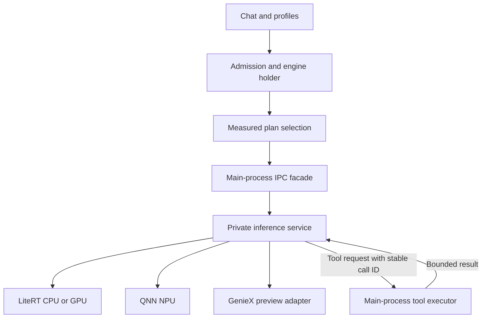

# GPU/NPU execution plans and reliability

Implementation branch: `feat/gpu-npu-execution-plans-2026-10-11`.
Base: `feat/qnn-full-reliability-v2-2026-10-11` at `5574590965a3a79571a16fa421979b4a3c2cc310`.
Design input: **GPT Mobile AI — GPU + NPU Design and Implementation Plan**, 11 October 2026.

The requested feature branch supersedes the document's suggestion to branch from main. This base already uses LiteRT-LM **0.18.0** and QAIRT **2.51.0**; the implementation preserves those pins instead of downgrading to the document's older QAIRT 2.50.0 baseline. Chat database version 37 is unchanged.

## What this changes

Local inference runs in a private `:local_inference` process behind the existing `LocalRuntime` interface. The main process retains the admission lease, conversation history, tool execution and credentials. A native crash can terminate the worker without taking those owners with it. A request that loses its worker is interrupted; tools and prompts are never automatically replayed.

The default execution policy remains **Profile**, preserving explicit accelerator choices. Auto, Stability, Speed and Battery select only from locally qualified, comparable evidence. Quick measurements do not qualify a plan. No new GPU/NPU execution mode is enabled by this change, and no token-speed improvement is claimed without measurements on the actual device.



## Requirement map

All Kotlin paths below are relative to `app/src/main/kotlin/dev/chungjungsoo/gptmobile/`.

| Requirement | Implementation | Status and qualification boundary |
| --- | --- | --- |
| R01 Typed plans | `data/localruntime/LocalExecutionPlan.kt` | Serializable policy, mode, plan, evidence key, status and decision types. Unknown native modes cannot enter normal routing. |
| R02 Metrics and baseline | `LocalRuntime.kt`, `LocalRuntimeImpl.kt`, `data/benchmark/LocalRuntimeBenchmarkSuite.kt` | Native prefill/decode and first visible answer are separate. Estimated character rates never become qualification counters. Quick and sustained comparisons retain failures. |
| R03 MTP | `LocalConversationConfig`, `LiteRtLmAdapter`, `LocalRuntimeImpl` | Engine and conversation policy propagation; explicit Off preserved; unsupported On rejected. Effective activation remains unknown when the SDK does not report it. |
| R04 Reuse | `LocalEngineHolder`, `LiteRtLmAdapter`, `LocalReuseDiagnostics` | Engine and conversation reuse/rebuild counters; existing dirty-history and configuration checks retained. Cache identity includes artifact, runtime, dispatch, firmware and tuning. |
| R05 Measured planner | `LocalExecutionPlanner`, `PlannedLocalRuntime` | Qualification and exact identity checks precede ranking. Warm-state switching cost included. Long-output and Speed decisions require sustained counters. |
| R06 Process service | `LocalInferenceService`, `ProcessLocalRuntime`, `GPTMobileApp`, manifest | Private bound worker, main-process startup gating and Binder death handling. Real device death/cancellation qualification remains required. |
| R07 Tool bridge | `data/localruntime/ipc/RuntimeWire.kt`, service and facade | Request/session/worker generation/sequence IDs, tool call IDs, allowlist, timeouts and payload budgets. Tool execution remains in the main process. |
| R08 Streaming/cancellation | `LocalEventBuffer`, `LocalRuntimeImpl`, service/facade | Ordered Unicode-safe chunks, reserved terminal capacity, bounded queues and explicit overflow. New work waits for native completion; a stuck worker is terminated. |
| R09 Quarantine | `NativeOperationJournal`, `NativeExitEvidence`, QNN guard | Stage/PID/time metadata, Android exit-cause correlation and exact-tuple quarantine. Low-memory/user exits are scheduling evidence. Explicit isolated verification API is separate from ordinary retry. |
| R10 Admission | `LocalWorkloadAdmission`, `DeviceHardwareGovernor`, `PlannedLocalRuntime` | Memory reserve, severe-heat rejection and helper recovery hysteresis. No hidden top-K or context reductions. |
| R11 Helpers | `ChatRepositoryImpl` admission and existing `InferenceAdmission` | Existing warm helper work stays serialized and bounded. Concurrent GPU/NPU helper inference remains disabled until independent native handles and device gates exist. |
| R12 Settings | `presentation/ui/setting/LocalRuntimeSettings*` | Policy, active runtime, requested/effective MTP, progress/Stop, native comparison table, provenance counts and disabled advanced modes. |
| R13 Persistence | `BenchmarkDatabase`, `BenchmarkStore`, existing complete-backup route | Additive database v1→v2 migration; raw trials, qualifications and bounded decision log. Backup v2 accepts v1 and legacy lists. Imported evidence is historical. |
| R14 Vision/GenieX | Per-modality metadata and experiment prerequisites | Existing modality/backend constraints retained. No untested GPU-vision/NPU-text or GenieX CPU/NPU hybrid claim. |
| R15 Native GPU/NPU research | Typed disabled experiment modes and `RuntimeReleaseGates` | Tensor partitioning, KV transfer and token-level speculative verification need a native feasibility adapter and hardware measurements; no fake Kotlin implementation. |

## Policy and identity

The qualification key covers hashed device/firmware identity, runtime versions, dispatch library contents, artifact digest, language and vision backends, context, sampler, MTP, workload, CPU threads, cache policy and suite revision. Model paths, prompts and tool secrets are excluded from portable runtime evidence. An artifact digest also represents its bundled tokenizer/template identity; different exports are separate cohorts.

- **Profile:** retain the explicit profile configuration.
- **Auto:** minimize estimated answer time, including load cost, first visible latency and output length.
- **Stability:** prioritize the qualified completion record, then estimated answer time.
- **Speed:** use qualified sustained decode evidence, including switching cost.
- **Battery:** require measured energy per token; otherwise retain the profile.

Only `QUALIFIED` evidence with confirmed backend execution and equivalent quality is eligible. Historical, measured-only, missing, incompatible and unsupported results cannot win. An unchanged warm plan avoids its measured load penalty. Selection happens before opening the conversation, under the engine holder's existing lease. A fallback loses the original plan's qualification label. Compiled NPU packages are never relabeled as CPU/GPU packages.

The native SDK does not currently report effective MTP activation through this adapter. The UI therefore shows **requested** separately from **active: not reported**. Requested MTP is not proof that a drafter ran.

## Process, streaming and cancellation contracts

The service is non-exported and checks the calling UID. It accepts only app-owned installed model paths and selects dispatch libraries itself. Main-process application startup uses lazy providers and returns early in the worker, avoiding the chat database, durable queue and gateway startup there. This is crash isolation within the same app UID, not a security sandbox or network permission boundary.

Protocol v1 uses unique request/session IDs, a worker-generation UUID and monotonically increasing response sequence numbers. Small packets use Binder; large packets use an unlinked private file descriptor. Payloads are capped at 32 MiB, request images at 8 MiB/10 images, tool arguments at 16 KiB and tool results at 512 KiB. Tool calls have a 120-second deadline and are deduplicated within the conversation. Interrupted action outcomes are reported as unknown and require reconciliation.

The callback handoff has a 1 MiB text budget and 64 control slots, with terminal capacity reserved. Adjacent text is coalesced without dropping deltas; UTF-16 surrogate pairs remain intact across IPC chunks. A drain fence sends all preceding text downstream before dispatching a tool callback. The service permits at most eight unacknowledged text packets. The facade also has a bounded buffer. Overflow preserves the accepted prefix, emits an error and cancels native work; it never reports successful completion.

Native cancellation runs on IO. The adapter waits up to five seconds for a native terminal callback before declaring the worker unusable. The service cancellation watchdog terminates a stuck worker after ten seconds; the facade allows twelve seconds for cleanup before disconnecting and requesting shutdown. Only the private worker is terminated. Load, inspect, conversation and generation operations have finite outer deadlines. Worker death clears live session identity and fails pending requests once.

Quarantine markers are durable before native inspection, engine initialization, conversation creation and generation. On restart, `ApplicationExitInfo` distinguishes native crashes, low-memory exits, user stops, ANRs and unknown interruption. Unknown exits remain protective. An app version change alone does not remove protection. `allowVerification(spec)` is an explicit isolated harness operation for a matching tuple, not an automatic retry or general reset button.

## Comparison protocol

Open **Settings → Engine & performance → Compare on this device**, select an installed local profile and start a comparison. The existing foreground benchmark owner provides progress and Stop in its notification; navigation away from Settings does not cancel the run. Native inference foreground services use the declared `specialUse` type; Play distribution requires the corresponding foreground-service declaration/review.

The quick protocol has a six-minute overall deadline, rotated candidate order, six repetitions (the first is warm-up), two nominal prompt-size bands, fixed output budgets and explicit MTP candidates where package metadata allows them. It writes a pending record before each trial, then finalizes that same record on success, failure or cancellation. Startup recovery marks unfinished trials interrupted before another benchmark can start. Cold engine loads and warm engine reuse are labeled; conversations are rebuilt for this baseline. The prompt bands are workload labels, not tokenizer counts; measured native prefill counts are authoritative.

Sustained mode adds three continuous 15-minute blocks **per candidate**, rotating block order. Each block starts with a cold warm-up. Its overall deadline is ten minutes of setup plus fifty minutes per candidate. Moderate thermal pressure remains part of sustained measurement; severe pressure can interrupt the run. An interrupted or incomplete block does not establish sustained qualification. Charge state, thermal state, available system memory, worker PSS, timing, native counters, output count and app commit are retained. PSS is an end-of-segment sample, not peak allocation or a hardware power measurement.

The summary records `MEASURED`, never `QUALIFIED`. The NPU adapter uses its native default sampler, whereas CPU/GPU comparisons use the supported explicit deterministic sampler. These are different qualification cohorts and must not be presented as a controlled backend-only speedup. Cross-export comparisons additionally require a declared quality-equivalence protocol.

The included suite is the plain-text baseline. Tools, thinking, multi-turn reuse, images, constrained schemas, distributional MTP checks, energy measurement and paired confidence intervals belong to the device qualification harness. They must not inherit eligibility from plain-text results.

## Promotion gates and native experiments

`RuntimeReleaseGates` encodes the design's G1–G8 requirements. Promotion also requires retained matching raw trials; imported evidence cannot qualify.

| Gate | Required device evidence |
| --- | --- |
| G1 | Actual backend confirmed for the exact artifact/runtime/device. Library presence is insufficient. |
| G2 | At least 500 controlled turns, at least 99% expected completion, zero unhandled native crashes or ANRs. Report injected failures separately. |
| G3 | At least 50 cancellations, 10 worker deaths and 20 memory-pressure scenarios; no tool replay or stuck ownership. |
| G4 | Exact accepted-text reconstruction under a slow consumer, one terminal event and bounded memory. |
| G5 | Supported/unsupported MTP and every enabled workflow's correctness/schema fixtures. |
| G6 | Decode experiments: at least 15% median sustained gain over the fastest qualified single backend; paired 95% lower confidence bound above no gain. Vision/helper placement: lower end-to-end time with no more than 5% primary decode regression. |
| G7 | Declared quality-equivalence margin and no more than 10% p95 first-visible regression. |
| G8 | Upgrade, backup, restore, interrupted-session and stale-evidence behavior verified. |

All advanced modes remain unavailable independently of the normal route:

1. **GPU vision + NPU text:** matching modality metadata, image-to-answer timing, repeated-image behavior and memory tests.
2. **Bounded helper:** independent native handles, one helper maximum, resource lease, primary-throughput protection and end-to-end benefit.
3. **GenieX CPU/NPU:** a packaged HTP/CPU hybrid native adapter and qualified quantizations in the separate preview build. Existing GGUF/QAIRT validation remains intact.
4. **Tensor GPU/NPU:** supported buffer import, tensor layouts, partitioned operators, fences and shape precompilation. Profile copies, conversions and waits; do not assume zero-copy from shared RAM.
5. **Split prefill/decode:** compatible KV representation, positions, quantization and ownership transfer.
6. **GPU draft/NPU verify:** token-level verification, rollback and correct rejection sampling. Sending draft text as another chat prompt is not speculative decoding.

The default runtime interfaces do not expose the native hooks needed for items 3–6. Their disabled prerequisites are deliberate completion boundaries from the design. They require separate measured native changes.

## Storage, rollback and validation

`BenchmarkDatabase` v2 adds `runtime_trials`, `runtime_qualifications` and `runtime_decisions`. Runtime trials are capped at 10,000 and decision traces at 500. Pruning trials invalidates any qualification whose raw source IDs are no longer retained. Clearing runtime evidence also clears derived qualifications and decision traces. Existing general benchmark histories remain separate.

Complete backup continues using `internal/benchmark-results/benchmark-results.json`. Payload schema v2 includes the new records; v1 payloads and legacy run lists remain readable. Import is transactional and downgrades runtime evidence to `HISTORICAL`. Live sessions, native pointers, runtime binaries and KV caches are never serialized. The old app's v1-only decoder cannot read newly exported v2 evidence; preserve an older backup if planning a downgrade.

Process isolation defaults on. For explicit development rollback, build with `-PlocalInferenceProcess=false`; Settings labels the in-process fallback. This flag does not bypass quarantine. Reset execution policy to Profile to stop measured routing while preserving evidence. Experimental modes remain unavailable in either configuration.

Build validation commands (Java 21 and Android SDK 37):

```bash
# Disable optional ObjectBox build analytics during validation.
export OBX_DISABLE_ANALYTICS=true
./gradlew :app:compileDebugKotlin :app:testDebugUnitTest
./gradlew :app:compileDebugAndroidTestKotlin
python3 scripts/check_android_regex.py
python3 -m unittest discover -s scripts/tests
bash scripts/validate.sh resources
```

Focused tests cover policy identity, MTP Off, sustained/energy evidence, warm switching cost, Unicode reconstruction, overflow, resource hysteresis, quarantine exit classification, release gates, backup authority and database migration. Instrumented IPC tests cover the private process declaration, a large Unicode file-descriptor round trip, immediate follow-up requests, stale worker generation rejection and controlled worker death. Real cancellation/death/fault injection and native backend qualification must run on hardware; a compiled or skipped instrumentation test is not device evidence.

Executed checks and remaining release gates are recorded in [the branch validation record](validation/implementation-2026-10-11.md). No physical SM8750 device is available in the implementation environment, so GPU/NPU performance, native cancellation behavior and G1–G8 release qualification remain **Not tested**.

## Primary references retained from the design

- [LiteRT-LM 0.18.0 release](https://github.com/google-ai-edge/LiteRT-LM/releases/tag/v0.18.0) and [pinned Kotlin configuration](https://github.com/google-ai-edge/LiteRT-LM/blob/v0.18.0/kotlin/java/com/google/ai/edge/litertlm/Config.kt).
- [Google's on-device MTP discussion](https://developers.googleblog.com/blazing-fast-on-device-genai-with-litert-lm/). External measurements do not predict this phone's result.
- [LiteRT GPU interoperability](https://developers.google.com/edge/litert/next/gpu) and [NPU deployment](https://developers.google.com/edge/litert/next/npu).
- [HeteroLLM research](https://arxiv.org/html/2501.14794v1) and [GenieX supported platforms](https://github.com/qualcomm/GenieX/blob/main/docs/en/get-started/platforms.mdx).
- [Android thermal guidance](https://developer.android.com/games/optimize/adpf/thermal), [processes](https://developer.android.com/guide/components/processes-and-threads) and [ApplicationExitInfo](https://developer.android.com/reference/android/app/ApplicationExitInfo).

## Expanded scope

This branch also implements [the reported runtime log repairs](runtime-log-remediation.md) and [opt-in Deep Research](deep-research-implementation.md). These features use the same explicit permission, evidence and no-automatic-replay principles. They do not grant a native execution mode qualification or bypass the Gemma 4 crash guard.
